# CP/M - IDE

There are several implementations of CP/M available for the RC2014. Each implementation has its own focus, and the same is true here. For larger [RC2014 Zed](https://z80kits.com/shop/rc2014-zed/) based systems with 512kB RAM [RomWBW](https://github.com/wwarthen/RomWBW/tree/master) is the right solution. For your smaller [RC2014 Pro](https://z80kits.com/shop/rc2014-pro/) based systems with 64kB RAM read on.

For further technical reading, a longer [description of CP/M-IDE is here](https://feilipu.me/2022/03/23/cpm-ide-for-rc2014/). This description is slightly outdated, but it covers the basics.

## Concept

This CP/M-IDE is designed to provide support for CP/M 2.2 with either Z80 or 8085 CPUs while using a normal FATFS formatted hard drive. And further, to do so with the minimum of (no) additional modules, complexity, and expense.

In contrast to other CP/M implementations, CP/M-IDE includes performance optimised drivers from the [z88dk](https://github.com/z88dk/z88dk). The z88dk RC2014 support includes serial interface drivers for the ACIA Serial Module, for the SIO/2 Serial Module, and for the Single and Dual UART Serial Modules. Two disk interface types are supported, being the IDE Hard Drive Module for PATA attached drives of all types and also the Compact Flash Module for Compact Flash Cards and Adapters.

While multiple configurations are possible, and can be built up as desired, the most common options are provided as prebuilt HEX files which can be simply burned to a 32kB ROM.

- The RC2014 Z80 CF SIO build supports the __RC2014 Pro__ with the standard SIO/2 Serial Module and the Compact Flash Module 2.0 in their usual configurations.

- The RC2014 Z80 CF UART build supports the RC2014 Pro with either the Single or Dual __UART Serial Module__ and the Compact Flash Module 2.0.

- The RC2014 Z80 PATA SIO build supports the RC2014 Pro Module equipped with the __IDE Hard Drive Module__.

- The RC2014 Z80 CF ACIA build supports the RC2014 Pro with the standard ACIA Serial Module and the Compact Flash Module 2.0.

For the 8085 CPU Module.

- The RC2014 8085 CF ACIA build requires the 8085 CPU Module, the ACIA Serial Module and uses the Compact Flash v2.0 (CF) Module.

- The RC2014 8085 CF UART build requires the 8085 CPU Module, the UART Serial Module and uses the Compact Flash v2.0 (CF) Module.

- The RC2014 8085 PATA UART build requires the 8085 CPU Module, the UART Serial Module and uses the IDE Hard Drive Module.

In the SIO Serial Module builds, both ports are enabled. Both ports have a 127 byte software receive buffer supporting the SIO/2 receive quad hardware buffer, and a 31 byte software transmit buffer. The transmit function has direct cut-through when the software buffer is empty. Hardware __`/RTS`__ flow control of the SIO/2 is provided. Full IM2 interrupt vector steering is implemented.

In the Single and Dual UART Serial Module builds both ports are enabled if present. Both ports have a 127 byte software receive buffer. The UART hardware receive and transmit FIFOs are 16 bytes. Hardware __`/RTS`__ and automatic flow control are enabled.

In the ACIA Serial Module builds, the receive interface has a 255 byte software buffer, together with optimised buffer management supporting the 68B50 ACIA receive double buffer. Hardware __`/RTS`__ flow control of the ACIA is provided. The ACIA transmit interface is also buffered, with direct cut-through when the 31 byte software buffer is empty, to ensure that the CPU is not held in wait state during transmission.

__NOTE:__ All serial interfaces (on the ACIA Serial Module, on the SIO Serial Module, on the UART Serial Module, and on the 8085 CPU Module SOD) are configured for __115200 baud 8n2__.

__NOTE:__ To enable flow control with any Serial Module it is critical to use a USB Serial adapter that supports __`/RTS`__ on Pin 6. Typical FTDI USB Adapters pinout __`/DTR`__ to Pin 6. The [recommended USB Serial adapter](https://www.tindie.com/products/8086net/uusbusb-c-cdc-serial-adaptor-5v/) is available from 8086 Consultancy.

The IDE Hard Drive Module interface driver is optimised for performance and can achieve about 110kB/s. It does this by minimising error management and streamlining read and write routines. The assumption is that modern PATA attached IDE drives have their own error management and if there are errors from the IDE interface, then there are other issues at stake. The CF Module can achieve up to 200kB/s at file-system level, and it seems to provide best performance using SD Cards in SD to CF Card Adapters. Drive letters and the FAT rules are in [Modifications to the CCP and BDOS](docs/readme_ccp_bdos.md).

The IDE Hard Drive Module supports both PATA hard drives (including 3 1/2" magnetic platter, SSD, and DOM storage) and Compact Flash cards in their native 16-bit PATA mode, with buffered I/O provided by the 82C55 device. The IDE Hard Drive Module is the ideal way to attach "spinning rust" to your RC2014. Attaching one physical Master drive is supported.

The CP/M-IDE system mounts up to 16 drives, A: through P:, as directories on one FAT16 or FAT32 volume. A `CPMIDE.CFG` in the root of that volume starts CP/M when the machine boots, and only when that file names drive A. A copy in any other directory does not start CP/M. `EXIT` returns to the shell and stays there. Change to the directory that holds the file and type `cpm` on its own. Type `cpm` and a directory name to use the folders `A` through `P` inside that directory. A drive with no directory is empty. Drive A has to be present or CP/M does not start. The steps are in [Working drive](#working-drive).

CP/M-IDE v2.6 mounted up to four 8 MB container files. That procedure, including `frag` and `mkdrv`, is in [CP/M-IDE v2.6](docs/CPM-IDE-v2.6.md). Branch `cpm-ide-2.6` tracks that release. Tag `cpm-ide-v2.6` is the published v2.6 ROM.

A CP/M program uses the TPA, from `$0100` up to FBASE. FBASE is the word at `0006h` (`$F206`, `jp fbase`). The CCP sits inside that range. It is reloaded each time a program exits, because the program may have overwritten it. The space for each ROM is in [Modifications to the CCP and BDOS](docs/readme_ccp_bdos.md).

<div>
<table style="border: 2px solid #cccccc;">
<tbody>
<tr>
<td style="border: 1px solid #cccccc; padding: 6px;"><a href="https://github.com/feilipu/CPM-IDE/blob/master/docs/P1090689.JPG" target="_blank">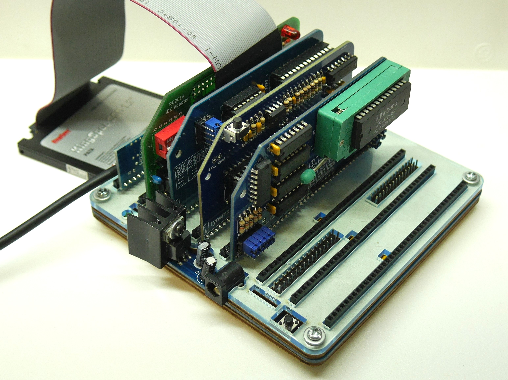</a></td>
</tr>
<tr>
<th style="border: 1px solid #cccccc; padding: 6px;"><center>RC2014 CP/M-IDE with IDE Module and ACIA Module</center></th>
</tr>
<tr>
<td style="border: 1px solid #cccccc; padding: 6px;"><a href="https://github.com/feilipu/CPM-IDE/blob/master/docs/IMG_0543.jpg" target="_blank">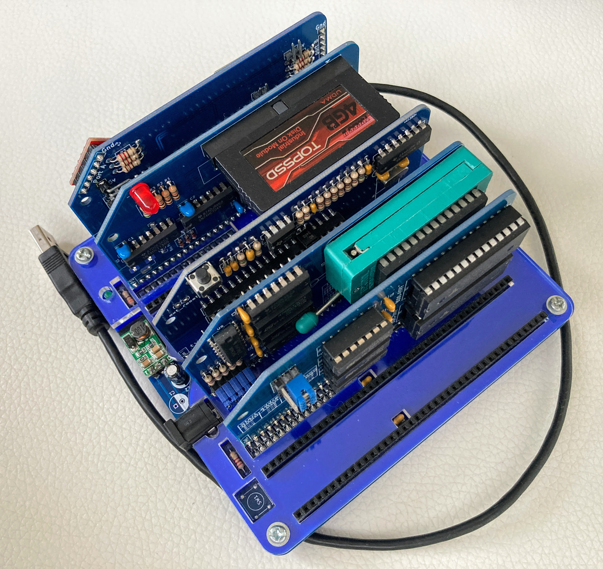</a></td>
</tr>
<tr>
<th style="border: 1px solid #cccccc; padding: 6px;"><center>RC2014 CP/M-IDE with DOM in an IDE Module and SIO Module (front view)</center></th>
</tr>
<tr>
<td style="border: 1px solid #cccccc; padding: 6px;"><a href="https://github.com/feilipu/CPM-IDE/blob/master/docs/IMG_0542.jpg" target="_blank">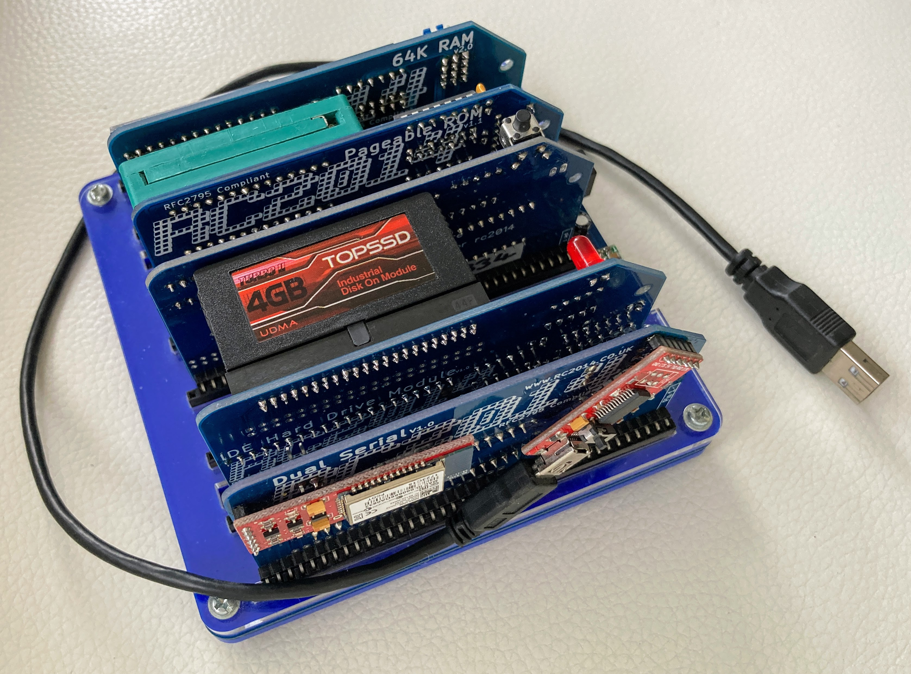</a></td>
</tr>
<tr>
<th style="border: 1px solid #cccccc; padding: 6px;"><center>RC2014 CP/M-IDE with DOM in an IDE Module and SIO Module (back view)</center></th>
</tr>
<tr>
<td style="border: 1px solid #cccccc; padding: 6px;"><a href="https://github.com/feilipu/CPM-IDE/blob/master/docs/IMG_1688.JPG" target="_blank">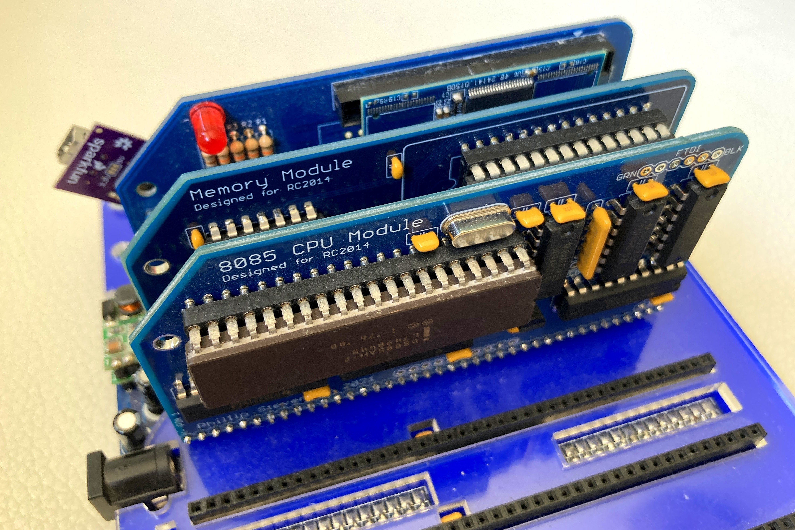</a></td>
</tr>
<tr>
<th style="border: 1px solid #cccccc; padding: 6px;"><center>RC2014-8085 CP/M-IDE with DOM in an IDE Module and ACIA Module</center></th>
</tr>
</tbody>
</table>
</div>


## Hardware

For the [RC2014 Pro](https://z80kits.com/shop/rc2014-pro/) no additional hardware is required. It is recommended to use a modern Compact Flash card of 1GB (or greater, up to 128GByte, or use a uSD-CF Adapter) to allow unrestricted storage of multiple CP/M drives.

For the RC2014 IDE Module builds, in addition to the [RC2014 Pro](https://z80kits.com/shop/rc2014-pro/) which contains the CPU and SIO Serial modules, just the IDE Hard Drive Module is necessary.

1. [IDE Hard Drive Module](https://rc2014.co.uk/modules/ide-hard-drive-module/).

Using the IDE Hard Drive Module the widest variety of PATA attached hard disks are supported. This is the way to connect 80's and 90's spinning disks for maximum "retro appeal".

__NOTE:__ If you are using the IDE Hard Drive Module 40-pin PATA connector, be aware that this connector does not pass power to the attached disk, DOM, or CF adapter. A 5" disk or 3 1/2" disk must be powered by its own 4-pin MOLEX connector. A 40-pin DOM or CF adapter must be powered by its own accessory power connector. Connecting +5V power to the barrel jack on the IDE Hard Drive Module is not sufficient to power 40-pin devices.

As noted above, the complete RC2014 Pro system must include:

2. [CPU Module](https://rc2014.co.uk/modules/cpu/z80-cpu-v2-1/).
3. [Clock Module](https://rc2014.co.uk/modules/clock/).
4. [64k RAM Module](https://rc2014.co.uk/modules/64k-ram/).
5. [Pageable ROM Module](https://rc2014.co.uk/modules/pageable-rom/).
6. [SIO Dual Serial Module](https://rc2014.co.uk/modules/dual-serial-module-sio2/).
7. [Backplane 8](https://rc2014.co.uk/modules/backplane-8/) or [Backplane Pro](https://rc2014.co.uk/backplanes/backplane-pro/).

If your preference is to use a CF Card, or SD Card in a uSD-CF Adapter, then Dylan Hall's CF Card PPIDE Module can be exchanged for item 1. This Module provides seamless and reliable (CF Specification compliant) CF Card (or also SD Card Adapter) support, but doesn't provide a standard 40 pin or 44 pin IDE connector.

- [CF Card PPIDE Module](https://oshwlab.com/dylan_3481/cf-ppide-for-rc2014_copy).

It is possible to use the standard RC2014 CF Module v2.0 with either the RC2014 Pro, or with the 8085 CPU Module CF builds. As a supported RC2014 Module, the CF Module v2.0 by Tadeusz Pycio provides a very robust (CF Specification compliant) solution that will work with large Compact Flash cards (e.g. 1GB and greater), and with SD to CF Card Adapters.

- [CF Module](https://rc2014.co.uk/modules/compact-flash-module/).
- [CF Module v2.0](https://z80kits.com/shop/compact-flash-module/).

Optionally, replacing items 4. and 5. with the Memory Module (also compatible with Steve Cousins' SC108) avoids the need for a flying `PAGE` wire joining RAM and ROM Modules when using the Backplane 8.

- [Memory Module](https://www.tindie.com/products/feilipu/memory-module-pcb/).

To operate the RC2014 with an 8085 CPU the following CPU Module must be exchanged for items 2. and 3, and either an ACIA Serial Module or a UART Serial Module installed.

__NOTE:__ For use with the 8085 CPU Module, either the ACIA Serial Module or UART Serial Modules are supported.

- [8085 CPU Module](https://www.tindie.com/products/feilipu/8085-cpu-module-pcb/).

To operate the RC2014 with a Single or Dual UART Serial Module, install that module in exchange for item 6. Installation of multiple serial modules is not supported.

- [Dual UART Module](https://rc2014.co.uk/modules/dual-serial-module-16c2550/).

Additionally, the ACIA Serial Module from the [RC2014 Classic II](https://rc2014.co.uk/modules/serial-io/) could be substituted for item 6. the SIO Serial Module.<br>

- [ACIA Serial Module](https://z80kits.com/shop/tynemouth-68b50-clocked-serial-port/).

Also Grant Searle's [CP/M on breadboard](http://searle.x10host.com/cpm/index.html) hardware is supported if a 32kB ROM is used, and Steve Cousins' [SC108 Module (Z80, 128k RAM, 32k ROM)](https://smallcomputercentral.com/rcbus/sc100-series/sc108-z80-processor-rc2014/) Module could be exchanged for items 2., 3., 4., and 5., because Richard Deane cared enough to ask. Thanks Richard.

As noted, when used with the IDE Hard Drive Module, both SD Cards and Compact Flash cards are also supported in their native 16-bit PATA mode, as shown below. Otherwise, when using the CF Module from the RC2014 Pro, SD Cards and Compact Flash cards are supported in the Compact Flash 8-bit compatibility mode.

<div>
<table style="border: 2px solid #cccccc;">
<tbody>
<tr>
<td style="border: 1px solid #cccccc; padding: 6px;"><a href="https://lh3.googleusercontent.com/-fCgroN5mYU8/WrREnuPPowI/AAAAAAACR8U/IQoillkYPpYYg3ROctaQHdLqDRtZ5hwrwCLcBGAs/s1600/IMG_20180322_235743.jpg" target="_blank"></a></td>
</tr>
<tr>
<th style="border: 1px solid #cccccc; padding: 6px;"><center>RC2014 running CP/M-IDE by DJRM</center></th>
</tr>
<tr>
<td style="border: 1px solid #cccccc; padding: 6px;"><a href="https://github.com/feilipu/CPM-IDE/blob/master/docs/IMG_2255.JPG" target="_blank">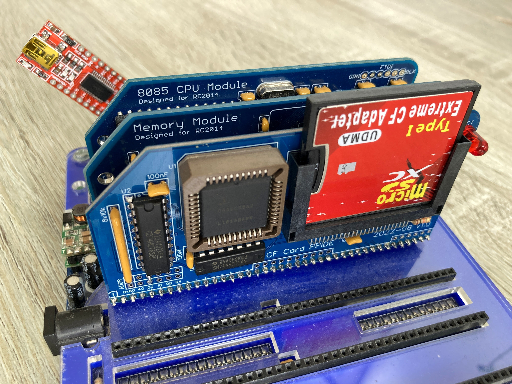</a></td>
</tr>
<tr>
<th style="border: 1px solid #cccccc; padding: 6px;"><center>RC2014-8085 running CP/M-IDE with SD to CF Storage Adapter</center></th>
</tr>
</tbody>
</table>
</div>

### Configuration

The modules are configured in their normal settings for CP/M. A jumper for the `PAGE` signal is shown connected via pin 39, although this can be done in any alternative way. To configure the RC2014 Pro see the jumper settings on the RAM Module and ROM Module, below pictures. Specifically the Pageable ROM Module needs to be configured for 32kByte Pages.

Rather than spend time on long written descriptions, one picture is worth 2kByte.

<div>
<table style="border: 2px solid #cccccc;">
<tbody>
<tr>
<td style="border: 1px solid #cccccc; padding: 6px;"><a href="https://github.com/feilipu/CPM-IDE/blob/master/docs/P1090691.JPG" target="_blank">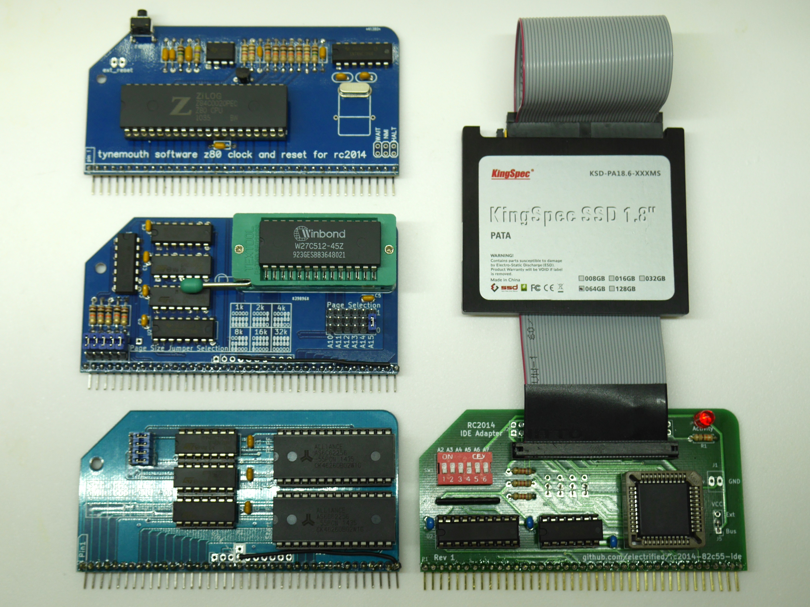</a></td>
</tr>
<tr>
<th style="border: 1px solid #cccccc; padding: 6px;"><center>RC2014 CP/M-IDE Modules (excl. ACIA)</center></th>
</tr>
<tr>
<td style="border: 1px solid #cccccc; padding: 6px;"><a href="https://github.com/feilipu/CPM-IDE/blob/master/docs/IMG_1689.JPG" target="_blank">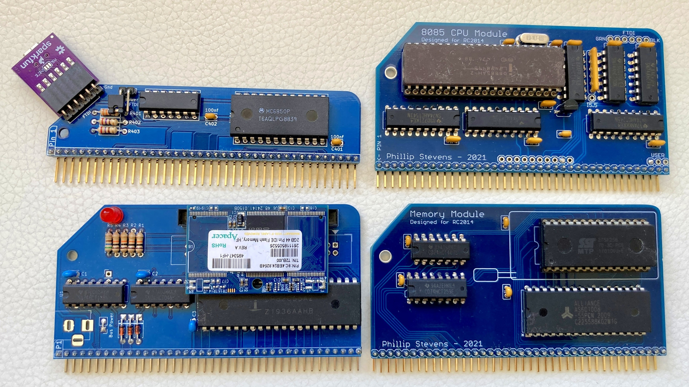</a></td>
</tr>
<tr>
<th style="border: 1px solid #cccccc; padding: 6px;"><center>RC2014 CP/M-IDE 8085 Modules</center></th>
</tr>
<tr>
<td style="border: 1px solid #cccccc; padding: 6px;"><a href="https://github.com/feilipu/CPM-IDE/blob/master/docs/IMG_0536.jpg" target="_blank">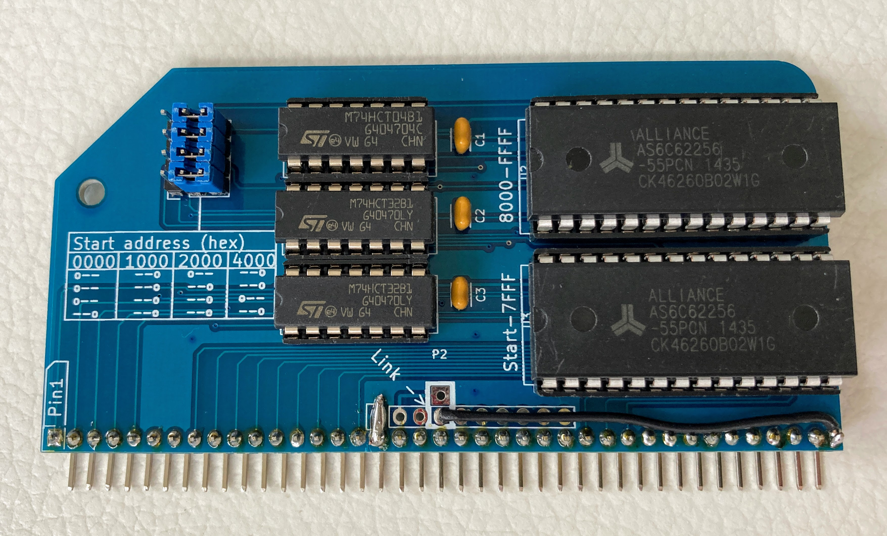</a></td>
</tr>
<tr>
<th style="border: 1px solid #cccccc; padding: 6px;"><center>RC2014 64kByte RAM Module (note jumper positions)</center></th>
</tr>
<tr>
<td style="border: 1px solid #cccccc; padding: 6px;"><a href="https://github.com/feilipu/CPM-IDE/blob/master/docs/IMG_0535.jpg" target="_blank">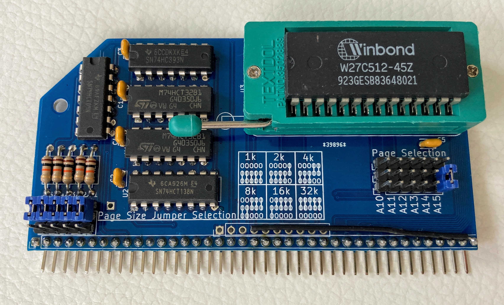</a></td>
</tr>
<tr>
<th style="border: 1px solid #cccccc; padding: 6px;"><center>RC2014 Pageable ROM Module (note jumper positions)</center></th>
</tr>
<tr>
<td style="border: 1px solid #cccccc; padding: 6px;"><a href="https://github.com/feilipu/CPM-IDE/blob/master/docs/IMG_0530.jpg" target="_blank">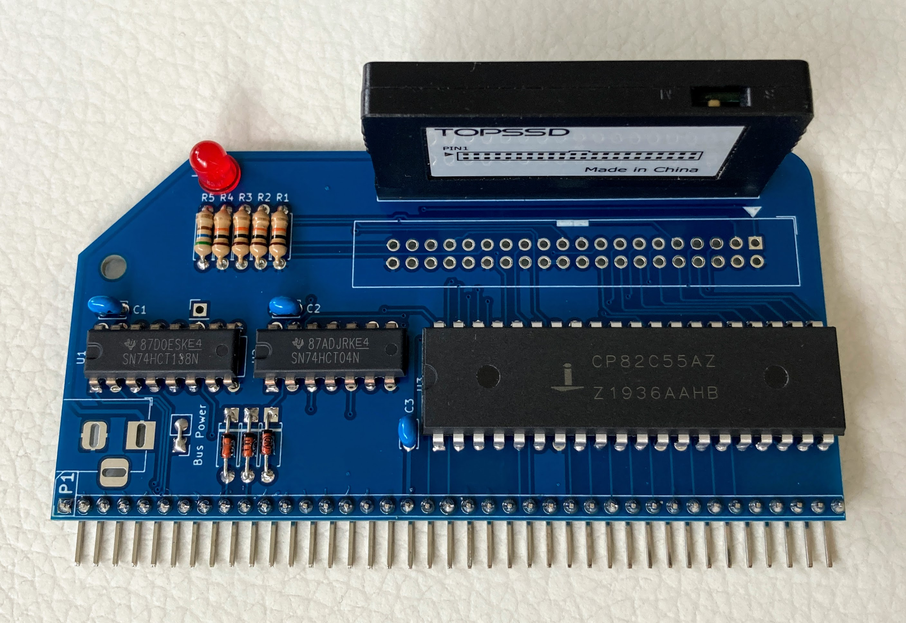</a></td>
</tr>
<tr>
<th style="border: 1px solid #cccccc; padding: 6px;"><center>RC2014 IDE Hard Drive Module with DOM</center></th>
</tr>
<tr>
<td style="border: 1px solid #cccccc; padding: 6px;"><a href="https://github.com/feilipu/CPM-IDE/blob/master/docs/IMG_0532.jpg" target="_blank">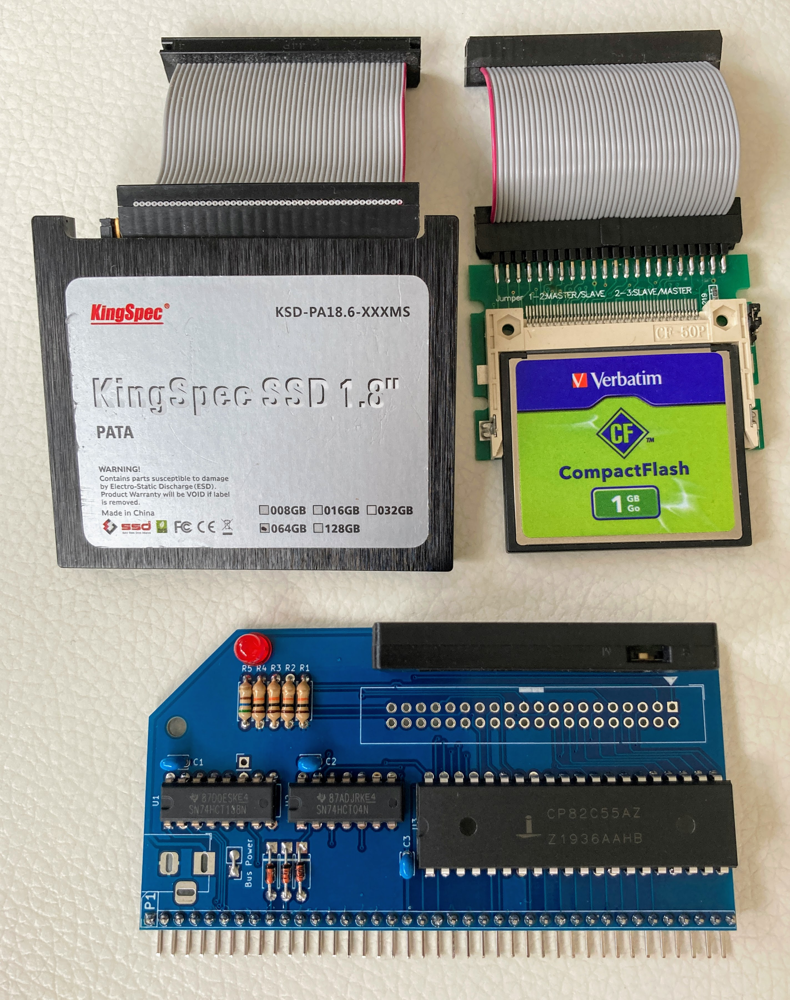</a></td>
</tr>
<tr>
<th style="border: 1px solid #cccccc; padding: 6px;"><center>RC2014 IDE Hard Drive Module storage options</center></th>
</tr>
</tbody>
</table>
</div>

## CP/M Software

The CP/M-IDE is built using the z88dk compilers and libraries, including a simple boot monitor or shell for the RC2014, together with the DRI CP/M CCP, a CP/M 2.2 BDOS whose disk is the FAT volume, and a CP/M BIOS constructed specifically for the RC2014 in the above hardware configurations.

#### CCP & BDOS Extension

The CCP command `EXIT` returns to the shell. You can then start CP/M from another directory.

The BDOS function 10 treats DEL as backspace. Digital Research Application Note 02 (APN 02) specifies that behaviour.

A command with no drive letter is tried again on `A:` when the `.COM` file is not on the current drive. An explicit drive letter searches only on that drive.

Further information on changes to the CCP and BDOS is in [Modifications to the CCP and BDOS](docs/readme_ccp_bdos.md). What each BDOS call returns is in [The CP/M 2.2 BDOS](docs/bdos.md). The FAT layer under it is in [Mini-FAT](docs/mini-fat.md).

#### BIOS Notes

The FAT volume rules are in the BIOS section of [Modifications to the CCP and BDOS](docs/readme_ccp_bdos.md).

### Installation

Using the correct HEX file for your hardware configuration from this directory, burn it into a 32kB or 64kB EEPROM, or PROM.

To initially configure your hard drive, use either a USB caddy for your PATA IDE drive, or a CF adapter for your Compact Flash card to put the card on your host computer. Format it FAT32, or FAT16 if it is small. On that volume, each CP/M drive is a directory. Put the programs for drive A in a directory, and do the same for any other letters you want. Then either list those directories in a file called `CPMIDE.CFG`, or put them in folders named `A` through `P` under one parent directory. The example files under [CPM Drives](https://github.com/feilipu/CPM-IDE/tree/master/CPM%20Drives) are disk images from the v2.6 set. Extract one with cpmtools into the letter directory. [Working drive](#working-drive) is how this ROM starts. The old container commands are in [CP/M-IDE v2.6](docs/CPM-IDE-v2.6.md).

Connect the RC2014 hardware as shown above, and then use the commands in [Usage of the Shell Command Interface](#usage-of-the-shell-command-interface).

### Boot-up Process

When the RC2014 first boots, the z88dk `crt0` preamble configures the machine.

The preamble copies the CCP and the resident BDOS stub into high RAM. `cboot` stores the BIOS canary as the word `$AA55`, low byte first. That word is the floor of the 16-byte BIOS stack, so a stack overrun lands on it. When the word is whole the BIOS stays in RAM, the mounted volume stays mounted, and control returns to the CCP. A jump to `0000h` takes that path. `EXIT` changes the `$AA` byte to `$55`. The preamble then clears the volume, copies the BIOS, and starts the shell, and the shell stays at the prompt. A cold start, or a canary that is `$00` or `$FF`, does the same copy and then looks for `CPMIDE.CFG` in the root only. CP/M starts when that file names drive A. A file in any other directory is ignored at boot.

The shell mounts the FAT volume. When `CPMIDE.CFG` is in the root and names drive A, CP/M starts from that file. A file somewhere else does not. Change to that directory and type `cpm` with no arguments. `EXIT` does not start CP/M again.

Command use is in [Usage of the Shell Command Interface](#usage-of-the-shell-command-interface).

Once `cpm` has mounted directory `A`, it pages out the ROM, writes a new Page 0 with the CP/M data and interrupt linkages, and passes control to the CCP.

In the 8085 CPU Module builds the CPU Serial Output (SOD) FTDI interface found on the CPU Module is also supported as the CP/M __`LPT:`__ device. It is enabled from within CP/M using __`^P`__ from the CCP command line as normal.

### Example programs

Cold and warm boot are both from ROM. There is no CP/M-IDE boot sector. Each drive letter is one directory on the FAT volume.

The [CPM Drives](https://github.com/feilipu/CPM-IDE/tree/master/CPM%20Drives) directory holds the example programs as 8 MB disk images: the [system utilities](https://github.com/feilipu/CPM-IDE/blob/master/CPM%20Drives/SYS.CPM.zip) (PIP, STAT, SD, SURVEY, XMODEM, MBASIC), [Zork](https://github.com/feilipu/CPM-IDE/blob/master/CPM%20Drives/ZORK.CPM.zip), [BBC Basic](https://github.com/feilipu/CPM-IDE/blob/master/CPM%20Drives/BBCBASIC.CPM.zip), [Hi-Tech C v3.09-15](https://github.com/feilipu/CPM-IDE/blob/master/CPM%20Drives/HITECHC.CPM.zip), [MS BASIC Compiler v5.3](https://github.com/feilipu/CPM-IDE/blob/master/CPM%20Drives/MSBASCOM.CPM.zip), and the others listed there. Extract an image into a letter directory with [`cpmtools`](cpmtools/readme_cpmtools.md). The [RunCPM](https://github.com/MockbaTheBorg/RunCPM/tree/master/DISK) set is the basis of the system image.

The [NGS Microshell](http://www.z80.eu/microshell.html) is on the system image as `SH`. It replaces the CCP for that session. Leave the DRI CCP in place. Replacing it removes `EXIT`.

How v2.6 mounted those images as drives, and the host `diskdef` used to build them, is in [CP/M-IDE v2.6](docs/CPM-IDE-v2.6.md).

## Usage of the Shell Command Interface

The shell is `common/yash.c`. The command line is in C. The functions under it are in C or in assembly. The serial interfaces (ACIA, SIO/2, UART, and 8085 SOD) use __115200 baud 8n2__. On the SIO module and the UART module the shell waits for a `:` to choose the port, and it keeps that port until CP/M starts. Flow control has to be on. An adapter that wires `/DTR` to pin 6 will drop characters on a long listing or a transfer. The adapter has to drive `/RTS`.

Burn the HEX that matches the disk module. A PATA ROM linked with the Compact Flash library answers `FR_NOT_READY` to `ls`. The PATA and CF settings are in [PATA versus Compact Flash](#pata-versus-compact-flash).

Backspace and DEL stop at the prompt. CR+LF, or LF+CR, is one end of line. The second byte does not start an empty command. The shell drops a byte below space or above 126. A NUL at the start of the line is an empty command, and the shell does not run it.

Ctrl-P and Ctrl-N recall up to 8 lines of 80 characters. The shell erases the previous line with backspace. The console drops a bare CR.

Again, here is a view of what success looks like.

<div>
<table style="border: 2px solid #cccccc;">
<tbody>
<tr>
<td style="border: 1px solid #cccccc; padding: 6px;"><a href="https://github.com/feilipu/CPM-IDE/blob/master/docs/cpm-idev8.png" target="_blank"></a></td>
</tr>
<tr>
<th style="border: 1px solid #cccccc; padding: 6px;"><center>RC2014 CP/M-IDE SIO - Shell CLI</center></th>
</tr>
</tbody>
</table>
</div>

### CP/M Functions
- `cpm` — start from `CPMIDE.CFG`, as described in [Working drive](#working-drive).
- `cpm <directory>` — start from the letter directories inside that directory. `cpm .` is that command for the directory you are in.
- `xget <file>` — receive an XMODEM-128 checksum file onto the FAT volume. The steps are in [Sending a file to the RC2014](#sending-a-file-to-the-rc2014).

From the CCP, `EXIT` returns to this shell and stays there. See [CCP & BDOS Extension](#ccp--bdos-extension).

### File System Functions
- `ls [path]` — directory listing. `ls` prints the free bytes on the volume after the names.
- `cd <path>` — change the current working directory
- `pwd` — show the current working directory
- `rm <file>` — delete a file. `rm` leaves a directory and a read-only file in place.
- `rmdir <path>` — remove an empty directory
- `mkdir <path>` — create a directory
- `cp <src> <dst>` — copy a file. `cp` allocates a new cluster chain.
- `mv <src> <dst>` — in one directory, `mv` renames the entry. To another directory, `mv` writes a new entry for the same chain and removes the old name. `mv` keeps the existing cluster chain.

### Disk Functions
- `ds` — disk status

### System Functions
- `help` — this is it
- `exit` — restart the RC2014

### Sending a file to the RC2014

__`xget`__ stores the file on the FAT volume. The shell follows the cluster chain, including a file that occupies more than one run. A file has to be 16 MB or less. The name on the card is the __`xget`__ argument, in 8.3 form. The seven HEX files include this command.

The transfer is XMODEM-128 with the checksum. The shell sends NAK, which selects that mode. Each acknowledged block is 128 data bytes. The stored length keeps the final block, including the usual `1Ah` padding. Leave the keyboard alone until the byte count is printed. A key typed into the same port is another byte in the packet.

With the serial link at __115200 baud 8n2__ and hardware flow control enabled:

```text
xget PROG.COM
```

__`xget`__ prints `Waiting for XMODEM`. Then send the file with `sx --checksum` (minicom: Ctrl-A S, then xmodem). The shell answers ACK after each good block is stored, so the host waits while a sector is written. EOT finishes the receive. Success prints the byte count. A quiet line prints `timeout`. CAN prints `cancelled`.

Once CP/M is running, `XMODEM` on drive A: receives a `.COM` straight into the current drive. An example host line:

```text
picocom -b 115200 -f h --stopbits 2 --send-cmd "sz -vv --xmodem" --receive-cmd "rz -vv -E --xmodem" /dev/ttyUSB0
```

### Working drive

A drive is a directory. A: has to be a real directory or CP/M does not start. A letter you leave out is an empty drive. Selecting that letter inside CP/M is a select error. Upper and lower case are the same name, so `drives/a` is `DRIVES/A`.

There are four ways to say which directory that is.

**1. Power on, from a file in the root.** `CPMIDE.CFG` in the root of the card starts CP/M during boot, and only when that file names drive A. A copy in any other directory is ignored at power on. `EXIT` returns to the shell and does not start CP/M again. A jump to `0000h` returns to the CCP, on the same user and drive, when the BIOS stack has not been overwritten.

**2. `cpm` with no arguments.** The shell reads `CPMIDE.CFG` in the working directory. When that directory has no such file, it reads the one in the root. A file in the working directory that does not name A: is kept. The root file is not used in its place. When there is no file, or the file does not name A:, `cpm` uses the letter directories in the working directory. If A: is still missing the shell prints `cpm <directory>` and stays at the prompt.

**3. `cpm .` after you have changed into the parent.** The dot is the directory you are in. Its children named `A` through `P` become the drives. This is the same set you get by typing the directory's own name once you are inside it.

```text
cd DRIVES
cpm .
```

**4. `cpm` and the directory name, from anywhere above it.** The children of that directory become the drives. You do not have to `cd` first.

```text
mkdir DRIVES
mkdir DRIVES/A
mkdir DRIVES/B
cpm DRIVES
```

`DRIVES/A` becomes `A:` and `DRIVES/B` becomes `B:`. Stop at the letters you need. `C` through `P` are empty when those directories are not there. The parent itself is not a drive. If you are already inside `DRIVES`, `cpm DRIVES` and `cpm .` mount the same letters.

**The config file.** Each line is a letter and a path. A space or an `=` separates them. A line that starts with `#` or `[` is skipped. The shell reads the first 511 characters. The path can be anywhere on the card. A quoted path is accepted.

```text
# system files on A, games on C
A DRIVES/A
B=DRIVES/B
C GAMES
```

Put that file in the root when the machine should enter CP/M at power on. Put a different file in a project directory when that project should choose its own letters, then `cd` there and type `cpm`. Several project directories can each have their own file. `EXIT` between them, and type `cpm` again.

On the first session, A: can hold the system files and another letter the work. `PIP` the commands you want onto the working directory. The CCP already has `DIR`, `ERA`, `TYPE`, `SAVE`, `REN`, `USER`, and `EXIT`. A command typed with no drive letter is tried on A: when the `.COM` is not on the current drive. A command typed with a drive letter searches only that drive. DEL is a backspace.

Keep a compiler or a game in its own letter directory. A crashed program can be replaced by sending the `.COM` again. The other letters stay as they were.

`USER` above 0 sees an empty disk, and a program cannot create a file there. Stay on user 0.

`SD`, `SURVEY`, and `STAT` report free space on the 8 MB disk the BDOS publishes. An empty letter reports 8192k, including on a card that is much larger. Each file reduces that figure by its size, rounded up to 2 KB. The number will not match a count of records. The directory's own clusters are not subtracted. The details are in [The CP/M 2.2 BDOS](docs/bdos.md).

Of course other workflows are fine. Extract [Zork](https://github.com/feilipu/CPM-IDE/blob/master/CPM%20Drives/ZORK.CPM.zip) into a letter directory and play a game.

## Building a CP/M application

A `.COM` runs in the TPA under the CCP. Build it with the RC2014 CP/M subtype. `open`, `read`, `write`, `lseek`, and `close` use the BDOS, and the BDOS writes the FAT directory on the card. Console I/O is also the BDOS.

```bash
zcc +rc2014 -subtype=cpm -clib=new app.c -o app -m
```

On v2.6 the BDOS could write only inside a container file. A program that had to create a file on the FAT volume itself linked ChaN FatFs. That recipe is in [CP/M-IDE v2.6](docs/CPM-IDE-v2.6.md).

This ROM does not link ChaN. The shell and the disk BDOS call mini-FAT, the sector and directory layer under ChaN's `f_open` and `f_read`. The public header is [`common/fatfs.h`](common/fatfs.h). Link `common/fatfs.asm` on the Z80, or `common/fatfs_85.asm` on the 8085, together with `common/fat_bss.asm`. Supply `asm_disk_initialize`, `ide_read_sector`, and `ide_write_sector`. There is no separate library archive. The calls are in [Mini-FAT](docs/mini-fat.md).

A program that still wants ChaN's `f_*` links the `ff` library. The line is in the v2.6 note.

## Building Software from Source

The z88dk command lines to build the **CP/M-IDE ROM** (firmware) for the Z80 CPU are below. These four images use sdcc (`-SO3`). For the RC2014, build with the `rc2014` target and the relevant subtype, from within the relevant directory.

First though, refer to the library, disk and buffer configuration notes below.

`zcc +rc2014 -subtype=sio -SO3 --opt-code-speed -m --max-allocs-per-node400000 @cpm22.lst -o ../rc2014-cpm22-z80-pata-sio -create-app`

`zcc +rc2014 -subtype=sio -SO3 --opt-code-speed -m --max-allocs-per-node400000 @cpm22.lst -o ../rc2014-cpm22-z80-cf-sio -create-app`

`zcc +rc2014 -subtype=uart -SO3 --opt-code-speed -m --max-allocs-per-node400000 @cpm22.lst -o ../rc2014-cpm22-z80-cf-uart -create-app`

`zcc +rc2014 -subtype=acia -SO3 --opt-code-speed -m --max-allocs-per-node400000 @cpm22.lst -o ../rc2014-cpm22-z80-cf-acia -create-app`


The z88dk command lines to build the CP/M-IDE for the 8085 CPU Module are below. These three images use 80cc (`-compiler=80cc`), with locals on the stack and no `-fframe-pointer`. 80cc accepts `--opt-code-speed` and ignores it, so these lines do not pass it. The `rc2014` target and relevant subtype should be selected, from within the relevant directory. Set `Z88DK` to your z88dk install root. The `-I${Z88DK}/include` path must precede the `_DEVELOPMENT/common` include path so classic `<stdio.h>` is used (required for `stdin`/`stdout` on the hybrid 8085 CRT).

`zcc +rc2014 -subtype=uart85 -compiler=80cc -O2 -m -D__CLASSIC -DAMALLOC -I${Z88DK}/include -I${Z88DK}/include/_DEVELOPMENT/common -I${Z88DK}/libsrc/target/rc2014 -L${Z88DK}/lib/clibs/sccz80 @cpm22.lst -o ../rc2014-cpm22-8085-pata-uart -create-app`

`zcc +rc2014 -subtype=uart85 -compiler=80cc -O2 -m -D__CLASSIC -DAMALLOC -I${Z88DK}/include -I${Z88DK}/include/_DEVELOPMENT/common -I${Z88DK}/libsrc/target/rc2014 -L${Z88DK}/lib/clibs/sccz80 @cpm22.lst -o ../rc2014-cpm22-8085-cf-uart -create-app`

`zcc +rc2014 -subtype=acia85 -compiler=80cc -O2 -m -D__CLASSIC -DAMALLOC -I${Z88DK}/include -I${Z88DK}/include/_DEVELOPMENT/common -I${Z88DK}/libsrc/target/rc2014 -L${Z88DK}/lib/clibs/sccz80 @cpm22.lst -o ../rc2014-cpm22-8085-cf-acia -create-app`

The 8085 host programs use 80cc as well. `sh test/bdos/run_disk.sh` builds the disk harness with `zcc +test -clib=8085 -m8085 -compiler=80cc` and `-pragma-define:REGISTER_SP=0`. That image is 65279 bytes. `z88dk-ticks` accepts a file of up to 65536 bytes, and the run prints `BDOS_DISK_OK`.

The Z80 `A>` under ticks is `sh test/cli/a.sh`. The script builds `test/cli/out/a.bin` and loads it at `$0100`. `DIR` and `TYPE HELLO.TXT` run on a RAM disk and return to `A>`. The recipe is in [`test/README.md`](test/README.md). The 8085 disk image is already near the 65536-byte ticks limit, so this session is Z80.

The ROM shell calls mini-FAT (`common/fatfs.h`, `common/fatfs.asm`). Volume rules and the drive map are in [Modifications to the CCP and BDOS](docs/readme_ccp_bdos.md).

The example images in `CPM Drives` are extracted with cpmtools. The diskdef and the recipes are in [`cpmtools/readme_cpmtools.md`](cpmtools/readme_cpmtools.md) and [CP/M-IDE v2.6](docs/CPM-IDE-v2.6.md).

ROM builds use the bare subtypes above. A `.COM` uses `-subtype=cpm`, as in [Building a CP/M application](#building-a-cpm-application).

The sizes of the serial transmit and receive buffers are set within the z88dk RC2014 target configuration files for the [ACIA](https://github.com/z88dk/z88dk/blob/master/libsrc/target/rc2014/config/config_acia.m4), [SIO/2](https://github.com/z88dk/z88dk/blob/master/libsrc/target/rc2014/config/config_sio.m4), and [UART](https://github.com/z88dk/z88dk/blob/master/libsrc/target/rc2014/config/config_uart.m4) respectively.

#### PATA versus Compact Flash

Mini-FAT uses the z88dk IDE driver. Set `__IO_CF_8_BIT` in `config_target.m4`, then rebuild the rc2014 libraries, then build the HEX.

- PATA (IDE Hard Drive Module, 8255 at `$20`–`$23`): `__IO_CF_8_BIT = 0`.
- Compact Flash Module (ports `$10`–`$17`): `__IO_CF_8_BIT = 1`.

A PATA ROM linked with the CF 8-bit library returns `FR_NOT_READY` on `ls`. A later `fat_mount` can still print `FR_OK` because it does not talk to the disk.

The disk access configuration, for either 16-bit PPIDE or 8-bit CF IDE, is [configured here](https://github.com/z88dk/z88dk/blob/master/libsrc/target/rc2014/config/config_target.m4#L22). PATA HEX files in this tree were built with `__IO_CF_8_BIT = 0`. CF HEX files were built with `__IO_CF_8_BIT = 1`. Rebuild the rc2014 libraries when you change that flag. Do not mix a PATA HEX with a CF library. The availability of the shadow RAM for 128kB RAM systems ([SC108](https://smallcomputercentral.com/rcbus/sc100-series/sc108-z80-processor-rc2014/), etc) is [configured here](https://github.com/z88dk/z88dk/blob/master/libsrc/target/rc2014/config/config_ram.m4#L10). Following changes to any of the configurations, the z88dk libraries for RC2014 should be rebuilt.

## Licence

The repository licence is [`LICENSE.txt`](LICENSE.txt). It is the MIT licence for this tree, and the Bryan Sparks grant for the Digital Research CP/M 2.2 Console Command Processor and Basic Input/Output System. Each product BIOS is derived from that CP/M BIOS.

_"Let this paragraph represent a right to use, distribute, modify, enhance, and otherwise make available in a nonexclusive manner CP/M and its derivatives. This right comes from the company, DRDOS, Inc.'s purchase of Digital Research, the company and all assets, dating back to the mid-1990's. DRDOS, Inc. and I, Bryan Sparks, President of DRDOS, Inc. as its representative, is the owner of CP/M and the successor in interest of Digital Research assets."_
[Reference](https://github.com/feilipu/CPM-IDE/blob/master/docs/BryanSparks-CPM-20220707.pdf)
