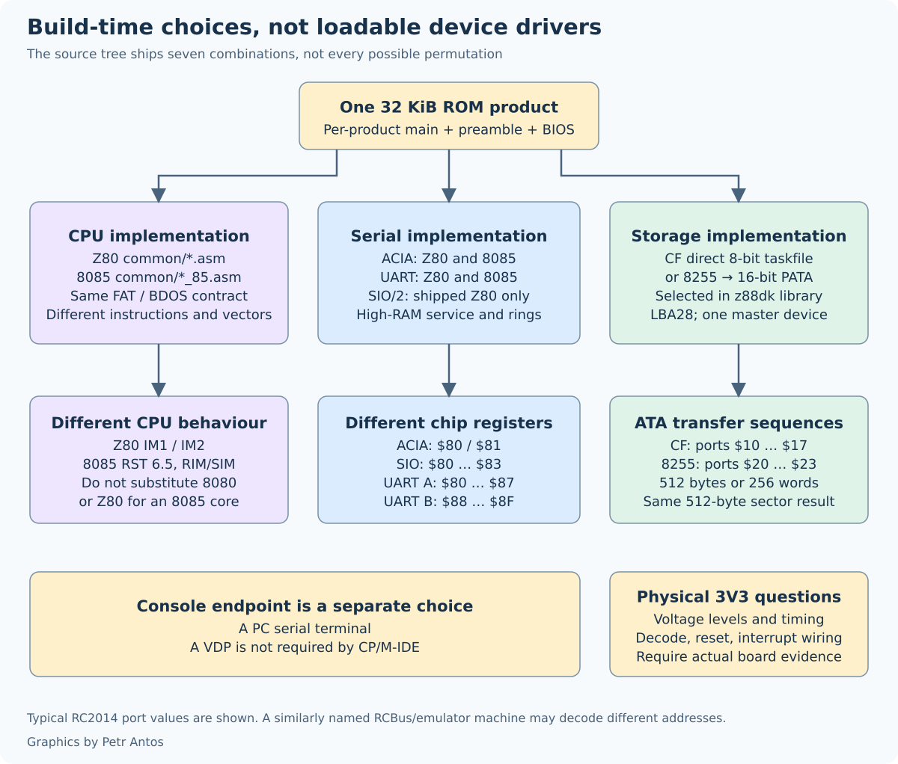
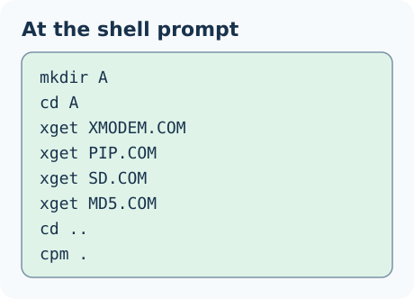

# CP/M - IDE

There are several implementations of CP/M available for the RC2014. Each implementation has its own focus, and the same is true here. For larger [RC2014 Zed](https://z80kits.com/shop/rc2014-zed/) based systems with 512kB RAM [RomWBW](https://github.com/wwarthen/RomWBW/tree/master) is the right solution. For your smaller [RC2014 Pro](https://z80kits.com/shop/rc2014-pro/) based systems with 64kB RAM read on.

For further technical reading, a longer [description of CP/M-IDE is here](https://feilipu.me/2022/03/23/cpm-ide-for-rc2014/). This description is slightly outdated, but it covers the basics.

## What it is

CP/M-IDE runs CP/M 2.2 on a Z80 or an 8085, from a 32 kB ROM, with a normal FAT16 or FAT32 disk. A drive letter is a directory on that one volume. A: through P: are sixteen directories, and further sets of those directories can live in other folders. The console is a serial terminal.

<table style="border: 2px solid #cccccc;">
<tbody>
<tr>
<td style="border: 1px solid #cccccc; padding: 6px;"></td>
</tr>
<tr>
<th style="border: 1px solid #cccccc; padding: 6px;">
RC2014 CP/M-IDE with <a href="https://rc2014.co.uk/ide-hard-drive-module/">IDE Module</a> and <a href="https://z80kits.com/shop/tynemouth-68b50-clocked-serial-port/">ACIA Module</a>
</th>
</tr>
<tr>
<td style="border: 1px solid #cccccc; padding: 6px;"></td>
</tr>
<tr>
<th style="border: 1px solid #cccccc; padding: 6px;">
<a href="https://www.tindie.com/products/feilipu/8085-cpu-module-pcb/">RC2014-8085</a> CP/M-IDE with DOM in an <a href="https://rc2014.co.uk/ide-hard-drive-module/">IDE Module</a> and <a href="https://z80kits.com/shop/tynemouth-68b50-clocked-serial-port/">ACIA Module</a>
</th>
</tr>
</tbody>
</table>

Each HEX file in this directory is one complete ROM for one combination of CPU, serial module, and disk module. The board runs that image. It does not load a driver from the card. There is no 8085 SIO ROM.

A program sees an ordinary CP/M 2.2 machine. The transient program area runs from `$0100` up to the word at `0006h`, which is `$F206`. How the ROM and the RAM fit together is in [How CP/M-IDE fits](docs/how-it-works.md).

v2.6, still published, mounts up to four 8 MB container files. The `cpm` command names those files. The first file named is drive A:, and each further file is the next drive, through D:. Each file has to be one contiguous run of clusters. The four files do not have to form one contiguous unit. That procedure is in [CP/M-IDE v2.6](docs/CPM-IDE-v2.6.md).

## Hardware

The usual machine is an [RC2014 Pro](https://z80kits.com/shop/rc2014-pro/): Z80, 64 kB RAM, a pageable 32 kB ROM, a serial module, and either the [Compact Flash Module](https://z80kits.com/shop/compact-flash-module/) or the [IDE Hard Drive Module](https://rc2014.co.uk/ide-hard-drive-module/). The [8085 CPU Module](https://www.tindie.com/products/feilipu/8085-cpu-module-pcb/) replaces the Z80 and the clock, and uses the [ACIA](https://z80kits.com/shop/tynemouth-68b50-clocked-serial-port/) or the [UART](https://rc2014.co.uk/dual-serial-module-16c2550/). A Compact Flash card of 1 GB or greater, up to 128 GiB, holds many sets of drives. An SD card in an SD-to-CF adapter uses the same Compact Flash interface.

Serial is 115200 baud, 8 data bits, no parity, 2 stop bits. The USB adapter has to drive `/RTS` on pin 6.

- Z80, [SIO/2](https://rc2014.co.uk/dual-serial-module-sio2/), [Compact Flash](https://z80kits.com/shop/compact-flash-module/)
- Z80, [UART](https://rc2014.co.uk/dual-serial-module-16c2550/), [Compact Flash](https://z80kits.com/shop/compact-flash-module/)
- Z80, [SIO/2](https://rc2014.co.uk/dual-serial-module-sio2/), [IDE Hard Drive Module](https://rc2014.co.uk/ide-hard-drive-module/)
- Z80, [ACIA](https://z80kits.com/shop/tynemouth-68b50-clocked-serial-port/), [Compact Flash](https://z80kits.com/shop/compact-flash-module/)
- [8085](https://www.tindie.com/products/feilipu/8085-cpu-module-pcb/), [ACIA](https://z80kits.com/shop/tynemouth-68b50-clocked-serial-port/), [Compact Flash](https://z80kits.com/shop/compact-flash-module/)
- [8085](https://www.tindie.com/products/feilipu/8085-cpu-module-pcb/), [UART](https://rc2014.co.uk/dual-serial-module-16c2550/), [Compact Flash](https://z80kits.com/shop/compact-flash-module/)
- [8085](https://www.tindie.com/products/feilipu/8085-cpu-module-pcb/), [UART](https://rc2014.co.uk/dual-serial-module-16c2550/), [IDE Hard Drive Module](https://rc2014.co.uk/ide-hard-drive-module/)

The modules, the jumper pictures, the ports, and the buffer sizes are in [Hardware](docs/hardware.md).

## Get started

Burn the HEX that matches that list into a 32 kB or 64 kB ROM. Format the card FAT32, or FAT16 if it is small. Make a directory called `A` and put the first programs there before CP/M starts.

`xget` is XMODEM-128 checksum (`sx --checksum`). The CCP already knows `DIR`, `ERA`, `TYPE`, `SAVE`, `REN`, `USER`, and `EXIT`. Leave a root `CPMIDE.CFG` out until A: has those files. A root file that names A: starts CP/M at power-on and skips the shell.

The shell commands, the config file, and the other ways to choose the drives are in [Getting started](docs/getting-started.md).

## Further reading

| | |
| --- | --- |
| [Getting started](docs/getting-started.md) | Burn the ROM, prepare the card, the shell, and the first `cpm`. |
| [Hardware](docs/hardware.md) | Modules, jumpers, serial, and the disk interface. |
| [How CP/M-IDE fits](docs/how-it-works.md) | The memory map, paging, and the TPA. |
| [Building](docs/building.md) | The seven ROM command lines, a `.COM`, and CF versus PATA. |
| [CP/M-IDE v2.6](docs/CPM-IDE-v2.6.md) | Container files, `frag`, and `mkdrv`. |
| [The CP/M 2.2 BDOS](docs/bdos.md) | What each call returns. |
| [Mini-FAT](docs/mini-fat.md) | The sector and directory layer. |
| [Modifications to the CCP and BDOS](docs/readme_ccp_bdos.md) | `EXIT`, the A: fallback, and the origins. |
| [CPM-IDE-MSX](docs/CPM-IDE-MSX.md) | The design record for this disk BDOS. |

Example programs are in [CPM Drives](CPM%20Drives). Host tools for the old images are in [`cpmtools/readme_cpmtools.md`](cpmtools/readme_cpmtools.md).

The same notes are on the [wiki](https://github.com/feilipu/CPM-IDE/wiki).

## Licence

The repository licence is [`LICENSE.txt`](LICENSE.txt). It is the MIT licence for this tree, and the Bryan Sparks grant for the Digital Research CP/M 2.2 Console Command Processor and Basic Input/Output System. Each product BIOS is derived from that CP/M BIOS.

_"Let this paragraph represent a right to use, distribute, modify, enhance, and otherwise make available in a nonexclusive manner CP/M and its derivatives. This right comes from the company, DRDOS, Inc.'s purchase of Digital Research, the company and all assets, dating back to the mid-1990's. DRDOS, Inc. and I, Bryan Sparks, President of DRDOS, Inc. as its representative, is the owner of CP/M and the successor in interest of Digital Research assets."_
[Reference](https://github.com/feilipu/CPM-IDE/blob/master/docs/BryanSparks-CPM-20220707.pdf)
