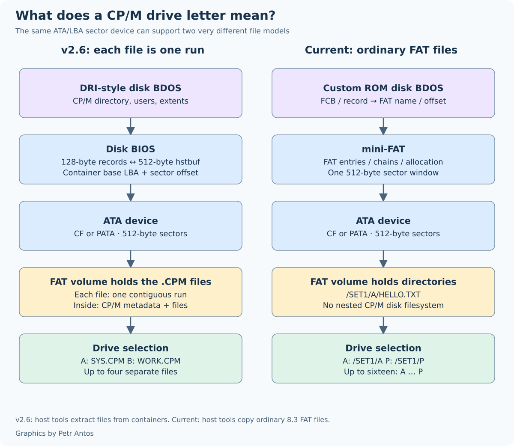
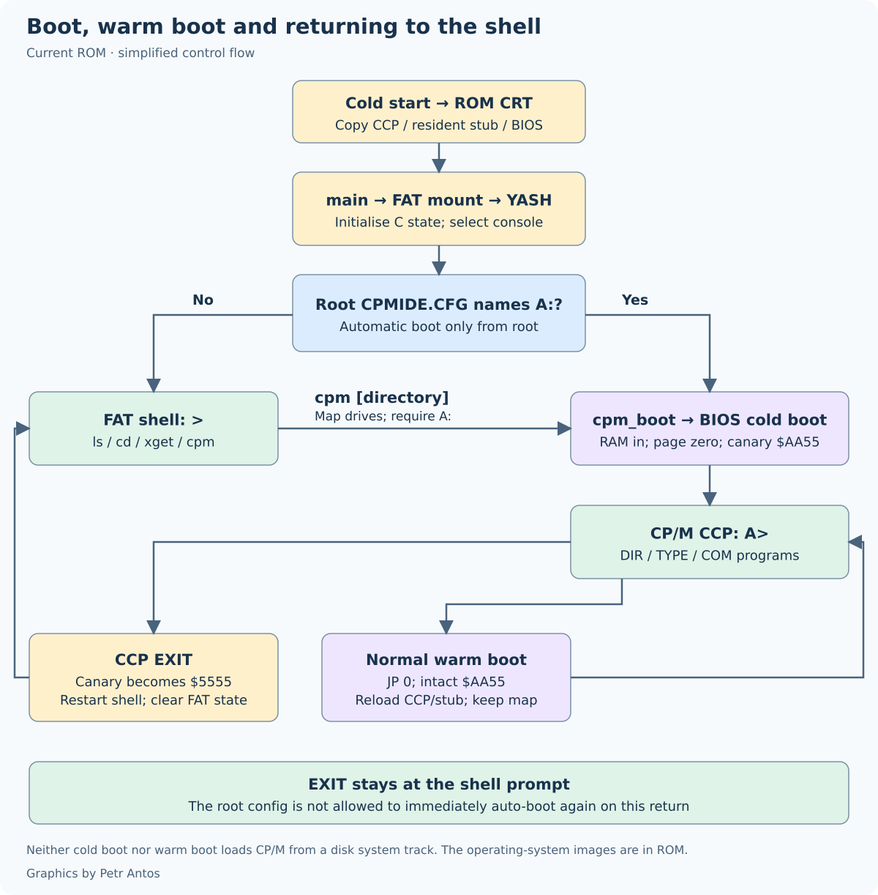
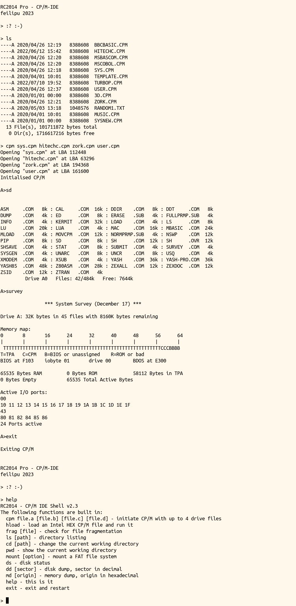
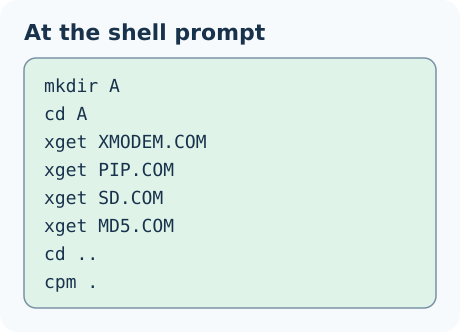

# Getting started

Burn the HEX that matches the CPU, the serial module, and the disk module. Format the card. Put a few programs in the directory that will be drive A:, then start CP/M from the shell. The seven HEX files and the module list are in [Hardware](hardware.md). The front [README](../README.md) is the short version of this page.

## What a drive is

The CP/M-IDE system mounts up to 16 drives, A: through P:, as directories on one FAT16 or FAT32 volume. Further sets of those sixteen directories can live in other directories on that volume, as many as the volume will hold. A full set is 128 MB when every letter is full. The volume is the only further limit: a 1 GB card holds about eight full sets, and a 16 GB card holds well over a hundred. Each letter is an 8 MB disk with 512 file names, and one file is at most 8 MB, so those 512 names share that 8 MB. The 8 MB figure is what a program is told. It is not a slice carved out of the card.

A `CPMIDE.CFG` in the root of that volume starts CP/M when the machine boots, and only when that file names drive A. A copy in any other directory does not start CP/M. A directory named `A` in the root does not start CP/M by itself. `EXIT` returns to the shell and stays there. Change to the directory that holds the file and type `cpm` on its own. Type `cpm` and a directory name to use the folders `A` through `P` inside that directory. A letter with no directory is not mounted. Selecting it inside CP/M is a select error, not a blank disk you can write. Drive A has to be present or CP/M does not start.

CP/M-IDE v2.6 mounted up to four 8 MB containers. Each container is one contiguous run of clusters. The four containers do not have to form one contiguous unit. That procedure, including `frag` and `mkdrv`, is in [CP/M-IDE v2.6](CPM-IDE-v2.6.md). Branch `cpm-ide-2.6` tracks that release. Tag `cpm-ide-v2.6` is the published v2.6 ROM.

Both arrangements move 512-byte sectors. v2.6 uses the FAT directory only to find each container, then reads a CP/M filesystem inside that container. Each container has to be one contiguous run of clusters, which is why `frag` exists. Other files and free space may sit between the four drives. This ROM keeps the CP/M names in the FAT directory itself. A file may be fragmented. A name copied onto the card from a PC is a name `DIR` can list.



A CP/M program uses the TPA, from `$0100` up to FBASE. FBASE is the word at `0006h` (`$F206`, `jp fbase`). Read that word. Do not hard-code the CCP address. The CCP sits inside the TPA. A program may overwrite it. A jump to address 0 copies the CCP back before the next prompt. How the ROM, the RAM, and that ceiling fit together is in [How CP/M-IDE fits](how-it-works.md). The CCP and BDOS changes are in [Modifications to the CCP and BDOS](readme_ccp_bdos.md).

A Z80 `.COM` is not an 8085 program. Both machines offer CP/M 2.2. The instruction set is not the same.

## Installation

Using the correct HEX file for your hardware configuration from the repository root, burn it into a 32 kB or 64 kB EEPROM, or PROM.

To initially configure your hard drive, use either a USB caddy for your PATA IDE drive, or a CF adapter for your Compact Flash card to put the card on your host computer. Format it FAT32, or FAT16 if it is small. On that volume, each CP/M drive is a directory. Put the programs for drive A in a directory, and do the same for any other letters you want. Then either list those directories in a file called `CPMIDE.CFG`, or put them in folders named `A` through `P` under one parent directory. The example files under [CPM Drives](../CPM%20Drives) are disk images from the v2.6 set. Extract one with cpmtools into the letter directory. Do not copy the `.CPM` file itself into that directory and expect `DIR` to list what is inside it. [Working drive](#working-drive) is how this ROM starts. The old container commands are in [CP/M-IDE v2.6](CPM-IDE-v2.6.md).

Connect the RC2014 as shown in [Hardware](hardware.md), and then use the commands below.

## Boot-up process

When the RC2014 first boots, the z88dk `crt0` preamble configures the machine.



The preamble copies the CCP and the resident BDOS stub into high RAM. `cboot` stores the BIOS canary as the word `$AA55`, low byte first. That word is the floor of the 16-byte BIOS stack, so a stack overrun lands on it. When the word is whole the BIOS stays in RAM, the mounted volume stays mounted, and control returns to the CCP. A jump to `0000h` takes that path. `EXIT` changes the `$AA` byte to `$55`. The preamble then clears the volume, copies the BIOS, and starts the shell, and the shell stays at the prompt. A cold start, or a canary that is `$00` or `$FF`, does the same copy and then looks for `CPMIDE.CFG` in the root only. CP/M starts when that file names drive A. A file in any other directory is ignored at boot.

A reset that leaves RAM intact is not a fresh power-on. The preamble reads the canary before the shell starts. `$AA55` jumps to `qboot`, keeps the mounted volume, and enters the CCP. `$5555` is the return from `EXIT`. Any other value is a cold start. What the reset did to the ROM latch matters as well. The mechanism is in [How CP/M-IDE fits](how-it-works.md).

The shell mounts the FAT volume. When `CPMIDE.CFG` is in the root and names drive A, CP/M starts from that file. A file somewhere else does not. Change to that directory and type `cpm` with no arguments. `EXIT` does not start CP/M again.

Once `cpm` has mounted directory `A`, it pages out the ROM, writes a new Page 0 with the CP/M data and interrupt linkages, and passes control to the CCP.

In the 8085 CPU Module builds the CPU Serial Output (SOD) FTDI interface found on the CPU Module is also supported as the CP/M __`LPT:`__ device. It is enabled from within CP/M using __`^P`__ from the CCP command line as normal.

## Example programs

Cold and warm boot are both from ROM. There is no CP/M-IDE boot sector. Each drive letter is one directory on the FAT volume.

The [CPM Drives](https://github.com/feilipu/CPM-IDE/tree/master/CPM%20Drives) directory holds the example programs as 8 MB disk images: the [system utilities](https://github.com/feilipu/CPM-IDE/blob/master/CPM%20Drives/SYS.CPM.zip) (PIP, STAT, SD, SURVEY, XMODEM, MBASIC), [Zork](https://github.com/feilipu/CPM-IDE/blob/master/CPM%20Drives/ZORK.CPM.zip), [BBC Basic](https://github.com/feilipu/CPM-IDE/blob/master/CPM%20Drives/BBCBASIC.CPM.zip), [Hi-Tech C v3.09-15](https://github.com/feilipu/CPM-IDE/blob/master/CPM%20Drives/HITECHC.CPM.zip), [MS BASIC Compiler v5.3](https://github.com/feilipu/CPM-IDE/blob/master/CPM%20Drives/MSBASCOM.CPM.zip), and the others listed there. Extract an image into a letter directory with [`cpmtools`](../cpmtools/readme_cpmtools.md). The [RunCPM](https://github.com/MockbaTheBorg/RunCPM/tree/master/DISK) set is the basis of the system image. A RunCPM tree keeps user areas as folders such as `A/0`. This BDOS does not. The files for a letter belong in that letter's directory. Copying the RunCPM tree unchanged leaves them one directory too deep. The programs in those archives keep their own licences. They are not covered by the MIT licence of this tree.

The [NGS Microshell](http://www.z80.eu/microshell.html) is on the system image as `SH`. The DRI CCP is in ROM, and a warm boot copies it back, so a CCP built to replace it does not stay. Type `SH` at the `A>` prompt. To start `SH` as CP/M boots, put that command in `A:$$$.SUB`. `SUBMIT` builds `A:$$$.SUB` from a `.SUB` script. The CCP runs that file when it starts, and again after a warm boot while the file is still on A:. A `.SUB` file under any other name stays on the disk until `SUBMIT` is run.

A CP/M text file normally uses CR/LF. Old text utilities treat Ctrl-Z (`1Ah`) as the end of the text. A short file written on a PC without that byte can show padding when those utilities read it.

How v2.6 mounted those images as drives, and the host `diskdef` used to build them, is in [CP/M-IDE v2.6](CPM-IDE-v2.6.md). `CPM Drives/DRI-CPM22` is already a set of ordinary files for this ROM.

## The shell

The shell is `common/yash.c`. The command line is in C. The functions under it are in C or in assembly. Shell commands are lowercase. The CCP accepts either case. The serial interfaces (ACIA, SIO/2, UART, and 8085 SOD) use __115200 baud 8n2__. On the SIO module and the UART module the shell waits for a `:` to choose the port, and it keeps that port until CP/M starts. Flow control has to be on. An adapter that wires `/DTR` to pin 6 will drop characters on a long listing or a transfer. The adapter has to drive `/RTS`.

Burn the HEX that matches the disk module. A PATA ROM linked with the Compact Flash library answers `FR_NOT_READY` to `ls`. The PATA and CF settings are in [PATA versus Compact Flash](building.md#pata-versus-compact-flash).

Backspace and DEL stop at the prompt. CR+LF, or LF+CR, is one end of line. The second byte does not start an empty command. The shell drops a byte below space or above 126. A NUL at the start of the line is an empty command, and the shell does not run it.

Ctrl-P and Ctrl-N recall up to 8 lines of 80 characters. The shell erases the previous line with backspace. The console drops a bare CR.

`exit` at the shell prompt restarts the RC2014. `EXIT` at the CP/M prompt returns to the shell and stays there. They are different commands.

This shell has no `mount`, `mkdrv`, `frag`, `dd`, or `md`. Those names belong to the v2.6 shell, and to some older notes. `help` prints the list this ROM actually has.

The picture below is an Example shell CLI. It is from 2023, so the banner and the `help` list are not this ROM.

<div>
<table style="border: 2px solid #cccccc;">
<tbody>
<tr>
<td style="border: 1px solid #cccccc; padding: 6px;"><a href="https://github.com/feilipu/CPM-IDE/blob/master/docs/cpm-idev8.png" target="_blank"></a></td>
</tr>
<tr>
<th style="border: 1px solid #cccccc; padding: 6px;"><center>Example shell CLI</center></th>
</tr>
</tbody>
</table>
</div>

### CP/M functions

- `cpm` — start from `CPMIDE.CFG`, as described in [Working drive](#working-drive).
- `cpm <directory>` — start from the letter directories inside that directory. `cpm .` is that command for the directory you are in. This command does not read a `CPMIDE.CFG` inside that directory.
- `xget <file>` — receive an XMODEM-128 checksum file onto the FAT volume. The steps are in [Sending a file to the RC2014](#sending-a-file-to-the-rc2014).

### CCP commands worth knowing here

The CCP command `EXIT` returns to the shell. You can then start CP/M from another directory.

The BDOS function 10 treats DEL as backspace. Digital Research Application Note 02 (APN 02) specifies that behaviour.

A command with no drive letter is tried again on `A:` when the `.COM` file is not on the current drive. An explicit drive letter searches only on that drive.

Further information on changes to the CCP and BDOS is in [Modifications to the CCP and BDOS](readme_ccp_bdos.md). What each BDOS call returns is in [The CP/M 2.2 BDOS](bdos.md). The FAT layer under it is in [Mini-FAT](mini-fat.md). The FAT volume rules are in the BIOS section of [Modifications to the CCP and BDOS](readme_ccp_bdos.md).

### File system functions

- `ls [path]` — directory listing. `ls` prints the free bytes on the volume after the names.
- `cd <path>` — change the current working directory
- `pwd` — show the current working directory
- `rm <file>` — delete a file. `rm` leaves a directory and a read-only file in place.
- `rmdir <path>` — remove an empty directory
- `mkdir <path>` — create a directory
- `cp <src> <dst>` — copy a file. `cp` allocates a new cluster chain.
- `mv <src> <dst>` — in one directory, `mv` renames the entry. To another directory, `mv` writes a new entry for the same chain and removes the old name. `mv` keeps the existing cluster chain.

### Disk functions

- `ds` — disk status

### System functions

- `help` — this is it
- `exit` — restart the RC2014

### Sending a file to the RC2014

__`xget`__ stores the file on the FAT volume. The shell follows the cluster chain, including a file that occupies more than one run. A file has to be 16 MB or less. The name on the card is the __`xget`__ argument, in 8.3 form. The seven HEX files include this command.

The transfer is XMODEM-128 with the checksum. The shell sends NAK, which selects that mode. Each acknowledged block is 128 data bytes. The stored length keeps the final block, including the usual `1Ah` padding. Leave the keyboard alone until the byte count is printed. A key typed into the same port is another byte in the packet.

With the serial link at __115200 baud 8n2__ and hardware flow control enabled:

```text
xget PROG.COM
```

__`xget`__ prints `Waiting for XMODEM`. Then send the file with `sx --checksum` (minicom: Ctrl-A S, then xmodem). The shell answers ACK after each good block is stored, so the host waits while a sector is written. EOT finishes the receive. Success prints the byte count. A quiet line prints `timeout`. CAN prints `cancelled`.

Before the first `cpm`, use `xget` from this shell to load the starter programs into the directory that will be A:. `XMODEM`, `PIP`, `SD`, and `MD5` are enough to get started, together with the CCP commands that are already built in. The example is in [Working drive](#working-drive).

Once CP/M is running, `XMODEM` on drive A: receives a `.COM` straight into the current drive. An example host line:

```text
picocom -b 115200 -f h --stopbits 2 --send-cmd "sz -vv --xmodem" --receive-cmd "rz -vv -E --xmodem" /dev/ttyUSB0
```

### Working drive

A drive is a directory. A: has to be a real directory or CP/M does not start. A letter you leave out is not mounted. Selecting that letter inside CP/M is a select error. Upper and lower case are the same name, so `drives/a` is `DRIVES/A`. The shell commands are lowercase. The CCP accepts either case.

There are four ways to say which directory that is.

**1. Power on, from a file in the root.** `CPMIDE.CFG` in the root of the card starts CP/M during boot, and only when that file names drive A. A copy in any other directory is ignored at power on. A folder named `A` in the root is not a substitute for that file. `EXIT` returns to the shell and does not start CP/M again. A jump to `0000h` returns to the CCP, on the same user and drive, when the BIOS stack has not been overwritten.

**2. `cpm` with no arguments.** The shell reads `CPMIDE.CFG` in the working directory. When that directory has no such file, it reads the one in the root. A file in the working directory that does not name A: is kept. The root file is not used in its place. When there is no file, or the file does not name A:, `cpm` uses the letter directories in the working directory. If A: is still missing the shell prints `cpm <directory>` and stays at the prompt.

**3. `cpm .` after you have changed into the parent.** The dot is the directory you are in. Its children named `A` through `P` become the drives. This is the same set you get by typing the directory's own name once you are inside it. The command does not read a `CPMIDE.CFG` in that directory.

```text
cd DRIVES
cpm .
```

**4. `cpm` and the directory name, from anywhere above it.** The children of that directory become the drives. You do not have to `cd` first. Again, a config file inside that directory is not read.

```text
mkdir DRIVES
mkdir DRIVES/A
mkdir DRIVES/B
cpm DRIVES
```

`DRIVES/A` becomes `A:` and `DRIVES/B` becomes `B:`. Stop at the letters you need. `C` through `P` stay unmounted when those directories are not there. The parent itself is not a drive. If you are already inside `DRIVES`, `cpm DRIVES` and `cpm .` mount the same letters.

**The config file.** Each line is a letter and a path. A space, a tab, or an `=` separates them. A line that starts with `#` or `[` is skipped. The shell reads one 512-byte sector and keeps the first 511 characters, so the useful file has to fit in that. The path can be anywhere on the card. A quoted path is accepted. Letters `A` through `P` ignore case.

The path has to be a real subdirectory, with a cluster number of 2 or more. Cluster 0 is the FAT16 root, and the root cannot itself be a drive.

```text
# system files on A, games on C
A DRIVES/A
B=DRIVES/B
C GAMES
```

Put that file in the root when the machine should enter CP/M at power on. Put a different file in a project directory when that project should choose its own letters, then `cd` there and type `cpm`. Several project directories can each have their own file. `EXIT` between them, and type `cpm` again.

Before the first `cpm`, seed A: from the shell. Leave a root `CPMIDE.CFG` out until these files are on A:. A file there that names A: starts CP/M at power on and skips this prompt. `XMODEM`, `PIP`, `SD`, and `MD5` are the useful set, along with any other program you want. The CCP already has `DIR`, `ERA`, `TYPE`, `SAVE`, `REN`, `USER`, and `EXIT`, so those do not need a file on the disk. The transfer is in [Sending a file to the RC2014](#sending-a-file-to-the-rc2014).



A command typed with no drive letter is tried on A: when the `.COM` is not on the current drive. A command typed with a drive letter searches only that drive. DEL is a backspace. Once `PIP` is on A:, it can copy further commands onto another letter.

Keep a compiler or a game in its own letter directory. A crashed program can be replaced by sending the `.COM` again. The other letters stay as they were.

`USER` above 0 sees an empty disk, and a program cannot create a file there. The `USER` command itself can still change the number. Stay on user 0. A search whose drive byte is `?` is the exception, and it is described in [The CP/M 2.2 BDOS](bdos.md).

`SD` and `STAT` report free space and the file count on the 8 MB disk the BDOS publishes. An empty letter reports 8192k, including on a card that is much larger. Each file reduces that figure by its size, rounded up to 2 KB. The number will not match a count of records. The directory's own clusters are not subtracted. The 8 MB is an accounting view, not a reserved slice of the card. Other files, directory clusters, and free space on the volume are still real FAT space, shared by every letter. The details are in [The CP/M 2.2 BDOS](bdos.md).

Of course other workflows are fine. Extract [Zork](https://github.com/feilipu/CPM-IDE/blob/master/CPM%20Drives/ZORK.CPM.zip) into a letter directory and play a game.

<p><a href="../README.md">Back</a></p>
