# Hardware

CP/M-IDE is built for an [RC2014 Pro](https://z80kits.com/shop/rc2014-pro/) with 64 kB of RAM and a 32 kB pageable ROM. The console is a serial terminal. A video display is not part of the machine. The seven HEX files are seven complete firmware images. They are not drivers loaded into a common system at run time. There is no 8085 SIO image.

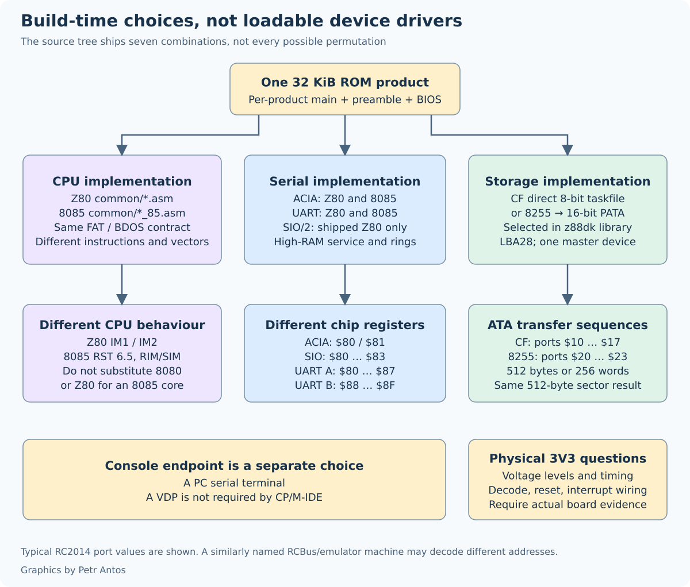

| Source directory | CPU | Serial | Disk |
| --- | --- | --- | --- |
| `z80-cf-acia` | Z80 | 68B50 ACIA | Compact Flash, 8-bit |
| `z80-cf-sio` | Z80 | SIO/2 | Compact Flash, 8-bit |
| `z80-cf-uart` | Z80 | 16x50 UART | Compact Flash, 8-bit |
| `z80-pata-sio` | Z80 | SIO/2 | IDE Hard Drive Module, 8255 |
| `8085-cf-acia` | 8085 | 68B50 ACIA | Compact Flash, 8-bit |
| `8085-cf-uart` | 8085 | 16x50 UART | Compact Flash, 8-bit |
| `8085-pata-uart` | 8085 | 16x50 UART | IDE Hard Drive Module, 8255 |

Each product's `cpm22.lst` brings in its own preamble and BIOS, and the common sources for that CPU. The shell chooses the directories, and on the SIO and UART modules it chooses the console port.

## Serial

All serial interfaces, including the 8085 CPU Module SOD pin, are __115200 baud 8n2__. Flow control has to be on. To enable it, the USB serial adapter has to drive __`/RTS`__ on pin 6. A typical FTDI adapter wires __`/DTR`__ to pin 6, and that adapter will drop characters. The [recommended USB serial adapter](https://www.tindie.com/products/8086net/uusbusb-c-cdc-serial-adaptor-5v/) is from 8086 Consultancy.

In the SIO Serial Module builds, both ports are enabled. Both ports have a 127 byte software receive buffer supporting the SIO/2 receive quad hardware buffer, and a 31 byte software transmit buffer. The transmit function has direct cut-through when the software buffer is empty. Hardware __`/RTS`__ flow control of the SIO/2 is provided. Full IM2 interrupt vector steering is implemented.

In the Single and Dual UART Serial Module builds both ports are enabled if present. Both ports have a 127 byte software receive buffer. The UART hardware receive and transmit FIFOs are 16 bytes. Hardware __`/RTS`__ and automatic flow control are enabled.

In the ACIA Serial Module builds, the receive interface has a 255 byte software buffer, together with optimised buffer management supporting the 68B50 ACIA receive double buffer. Hardware __`/RTS`__ flow control of the ACIA is provided. The ACIA transmit interface is also buffered, with direct cut-through when the 31 byte software buffer is empty, to ensure that the CPU is not held in wait state during transmission.

The usable depth is one byte under the allocated ring, which is where 255, 127, and 31 come from. The rings sit at the top of RAM and stay reachable while the ROM window is paged either way. On the Z80 the service routine in the BIOS copy serves both views. On the 8085 the ROM vector and the RAM vector can each enter their own copy, and both copies use those same rings.

| Module | Ports in these ROMs | Interrupt |
| --- | --- | --- |
| ACIA | `$80` status and control, `$81` data | Z80 mode 1, RST `$38`. 8085 RST 6.5 at `$0034`. |
| SIO/2 | `$80`–`$83` | Z80 mode 2 |
| UART | port A `$80`–`$87`, port B `$88`–`$8F` | Z80 mode 1, RST `$38`. 8085 RST 6.5 at `$0034`. |

These addresses are the z88dk RC2014 configuration the HEX files were built with. Another board, or another emulator, often decodes a UART at `$A0` or `$C0`. Match the ROM you burned. The buffer sizes are set in the z88dk files for the [ACIA](https://github.com/z88dk/z88dk/blob/master/libsrc/target/rc2014/config/config_acia.m4), the [SIO/2](https://github.com/z88dk/z88dk/blob/master/libsrc/target/rc2014/config/config_sio.m4), and the [UART](https://github.com/z88dk/z88dk/blob/master/libsrc/target/rc2014/config/config_uart.m4).

The 8085 SOD pin on the CPU Module is the CP/M __`LPT:`__ device. It is not a second UART. From the CCP, __`^P`__ turns list echo on, as usual. An 8085 ROM uses 8085 instructions, including `RIM` and `SIM`, and the serial interrupt is RST 6.5. An 8080 core will not run it, and neither will a Z80 core.

IOBYTE routing, and the choice of SIO or UART console port, sits on top of those registers. The shell waits for a `:` on the SIO and the UART. It keeps that port until CP/M starts.

## The disk

The IDE Hard Drive Module interface driver is optimised for performance and can achieve about 110 kB/s. It does this by minimising error management and streamlining read and write routines. The assumption is that modern PATA attached IDE drives have their own error management and if there are errors from the IDE interface, then there are other issues at stake. The CF Module can achieve up to 200 kB/s at file-system level, and it seems to provide best performance using SD Cards in SD to CF Card Adapters. Those figures are measurements of this driver on the author's hardware. They are not a promise for an emulator.

The IDE Hard Drive Module supports both PATA hard drives (including 3 1/2" magnetic platter, SSD, and DOM storage) and Compact Flash cards in their native 16-bit PATA mode, with buffered I/O provided by the 82C55 device. The name "Compact Flash" does not by itself choose the driver. A CF card, or an SD-to-CF adapter, plugged into the IDE module uses the 8255 path. The same card in the CF Module uses the 8-bit taskfile. The IDE Hard Drive Module is the way to attach spinning disks to an RC2014. One physical Master drive is supported.

The 8255 sits at `$20`–`$23`. One 512-byte sector is 256 words of 16 bits, and the 8-bit CPU sequences the two data bytes and the strobes. The CF Module exposes the ATA taskfile at `$10`–`$17` and moves the sector as 512 bytes. The Z80 driver can move that sector in blocks. The 8085 driver moves it a byte at a time. Both paths issue one sector per command. A serial interrupt can still be serviced during the wait.

__NOTE:__ The driver addresses one Master drive with 28-bit LBA and transfers one 512-byte sector per command. The high address byte keeps its low 4 bits. 2^28 sectors is 137,438,953,472 bytes, which is 128 GiB. That is the largest disk this interface can use. The Compact Flash module uses the same address. A larger disk is reachable only in that first 128 GiB. That ceiling is the ATA address. It is not the 8 MB a CP/M program is told, and it is not the 32 kB cluster limit of the FAT layer.

__NOTE:__ If you are using the IDE Hard Drive Module 40-pin PATA connector, be aware that this connector does not pass power to the attached disk, DOM, or CF adapter. A 5" disk or 3 1/2" disk must be powered by its own 4-pin MOLEX connector. A 40-pin DOM or CF adapter must be powered by its own accessory power connector. Connecting +5V power to the barrel jack on the IDE Hard Drive Module is not sufficient to power 40-pin devices.

Which library the HEX was linked with is a build choice. A PATA ROM linked with the Compact Flash library answers `FR_NOT_READY` to `ls`. The flag is in [Building](building.md#pata-versus-compact-flash).

## Modules

For the RC2014 Pro no additional hardware is required when the Compact Flash Module is the disk. It is recommended to use a modern Compact Flash card of 1 GB or greater, up to 128 GiB, or a uSD-CF adapter.

For the IDE module builds, in addition to the Pro, which contains the CPU and SIO modules, the IDE Hard Drive Module is the extra piece.

1. [IDE Hard Drive Module](https://rc2014.co.uk/ide-hard-drive-module/).

The complete RC2014 Pro system includes:

2. [CPU Module](https://rc2014.co.uk/z80-cpu-v2-1/).
3. [Clock Module](https://rc2014.co.uk/clock/).
4. [64k RAM Module](https://rc2014.co.uk/64k-ram/).
5. [Pageable ROM Module](https://rc2014.co.uk/pageable-rom/).
6. [SIO Dual Serial Module](https://rc2014.co.uk/dual-serial-module-sio2/).
7. [Backplane 8](https://rc2014.co.uk/backplane-8/) or [Backplane Pro](https://rc2014.co.uk/backplane-pro/).

If your preference is to use a CF card, or an SD card in a uSD-CF adapter, then Dylan Hall's CF Card PPIDE Module can be exchanged for item 1. This module provides CF-specification-compliant CF card and SD card adapter support. It does not provide a 40-pin or 44-pin IDE connector.

- [CF Card PPIDE Module](https://oshwlab.com/dylan_3481/cf-ppide-for-rc2014_copy).

The standard RC2014 CF Module v2.0 works with the Pro and with the 8085 CF builds. As a supported module, the CF Module v2.0 by Tadeusz Pycio is a CF-specification-compliant solution for large Compact Flash cards, 1 GB and greater, and for SD-to-CF adapters.

- [CF Module](https://rc2014.co.uk/compact-flash-module/).
- [CF Module v2.0](https://z80kits.com/shop/compact-flash-module/).

Optionally, replacing items 4 and 5 with the Memory Module, which is also compatible with Steve Cousins' SC108, avoids the flying `PAGE` wire between the RAM and ROM modules on the Backplane 8.

- [Memory Module](https://www.tindie.com/products/feilipu/memory-module-pcb/).

To operate the RC2014 with an 8085 CPU the following CPU module replaces items 2 and 3, and either an ACIA or a UART must be installed. Installation of more than one serial module is not supported.

- [8085 CPU Module](https://www.tindie.com/products/feilipu/8085-cpu-module-pcb/).

To operate with a Single or Dual UART, install that module in exchange for item 6.

- [Dual UART Module](https://rc2014.co.uk/dual-serial-module-16c2550/).

The [Serial I/O module](https://rc2014.co.uk/serial-io/) from the [RC2014 Classic II](https://rc2014.co.uk/rc2014-classic-ii/) can be substituted for item 6.

- [ACIA Serial Module](https://z80kits.com/shop/tynemouth-68b50-clocked-serial-port/).

Grant Searle's [CP/M on breadboard](http://searle.x10host.com/cpm/index.html) hardware is supported when a 32 kB ROM is used. Steve Cousins' [SC108](https://smallcomputercentral.com/rcbus/sc100-series/sc108-z80-processor-rc2014/) (Z80, 128 kB RAM, 32 kB ROM) can replace items 2, 3, 4, and 5.

RC2014, RCBus, and a 3.3 V supply are three different questions. These ROMs are built for the modules above. They have not been electrically tested on an RCBus 3.3 V machine. Before assigning one to that board, check the supply thresholds, the bus timing, the ACIA clock and the `$80`/`$81` decode, whether the interrupt really is 8085 RST 6.5 rather than the Z80 `/INT` wire, the port `$38` page, and the levels on the CF or PATA bus.

<table style="border: 2px solid #cccccc;">
<tbody>
<tr>
<td style="border: 1px solid #cccccc; padding: 6px;"><a href="https://github.com/feilipu/CPM-IDE/blob/master/docs/IMG_0543.jpg" target="_blank">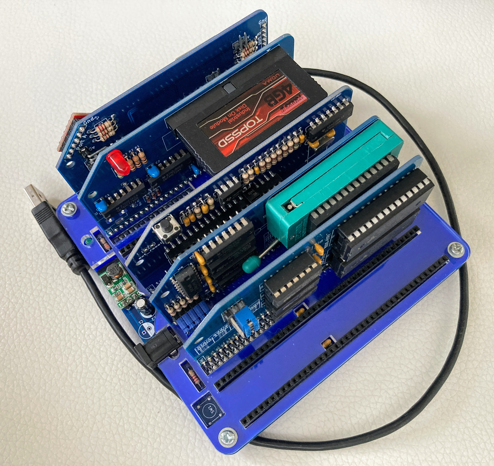</a></td>
</tr>
<tr>
<th style="border: 1px solid #cccccc; padding: 6px;">
RC2014 CP/M-IDE with DOM in an IDE Module and SIO Module (front view)
</th>
</tr>
<tr>
<td style="border: 1px solid #cccccc; padding: 6px;"><a href="https://github.com/feilipu/CPM-IDE/blob/master/docs/IMG_0542.jpg" target="_blank">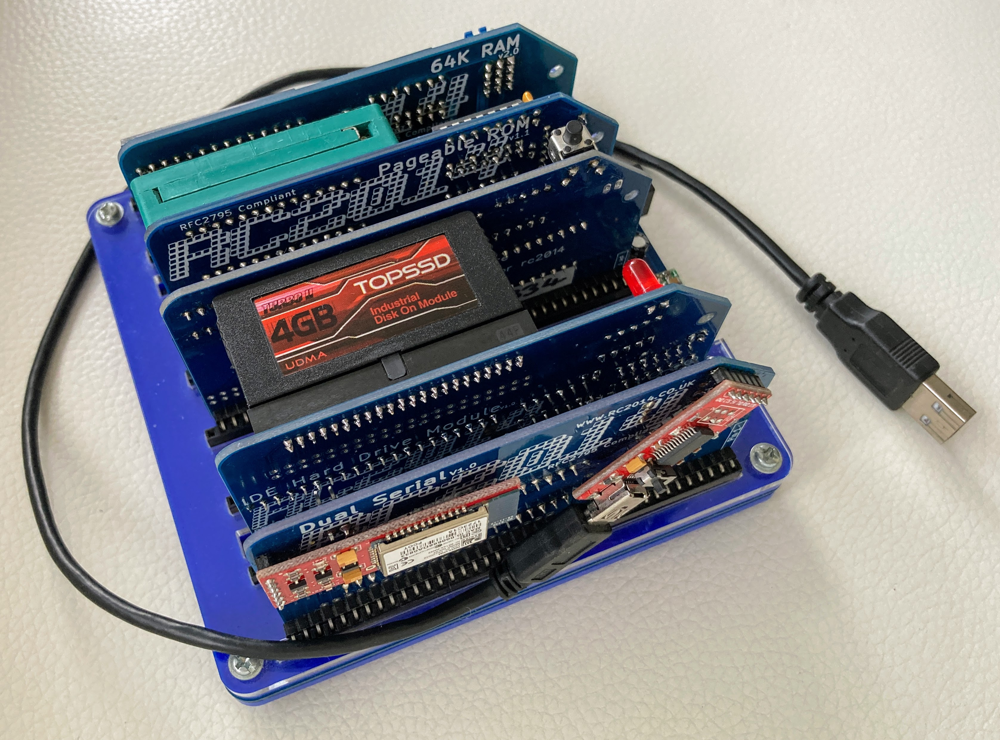</a></td>
</tr>
<tr>
<th style="border: 1px solid #cccccc; padding: 6px;">
RC2014 CP/M-IDE with DOM in an IDE Module and SIO Module (back view)
</th>
</tr>
<tr>
<td style="border: 1px solid #cccccc; padding: 6px;"><a href="https://github.com/feilipu/CPM-IDE/blob/master/docs/IMG_1688.JPG" target="_blank">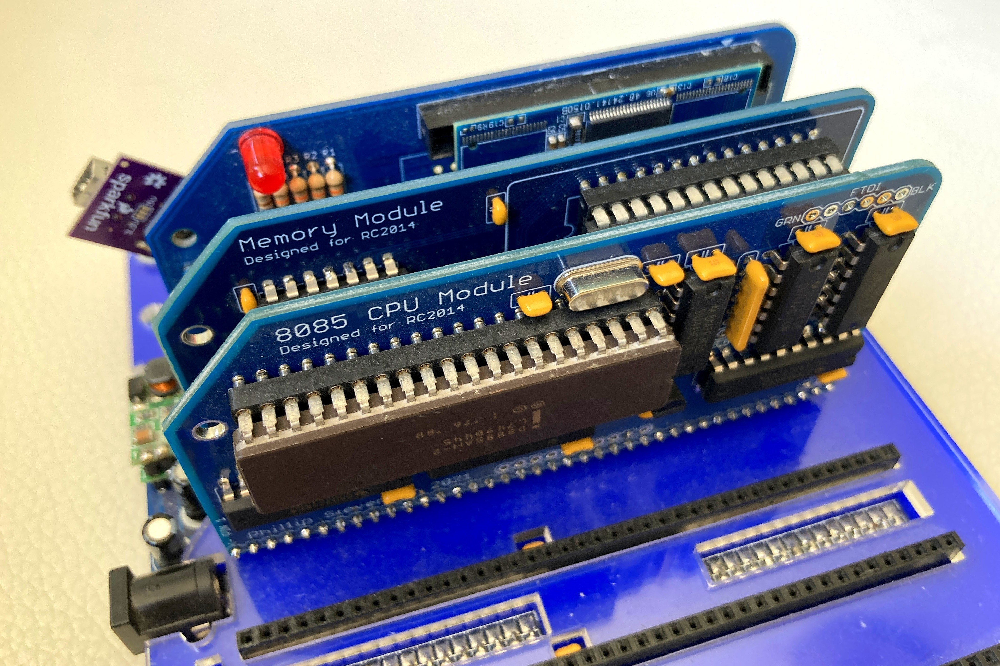</a></td>
</tr>
<tr>
<th style="border: 1px solid #cccccc; padding: 6px;">
RC2014-8085 CP/M-IDE with DOM in an IDE Module and ACIA Module
</th>
</tr>
<tr>
<td style="border: 1px solid #cccccc; padding: 6px;"></td>
</tr>
<tr>
<th style="border: 1px solid #cccccc; padding: 6px;">
RC2014 running CP/M-IDE by DJRM
</th>
</tr>
<tr>
<td style="border: 1px solid #cccccc; padding: 6px;"><a href="https://github.com/feilipu/CPM-IDE/blob/master/docs/IMG_2255.JPG" target="_blank">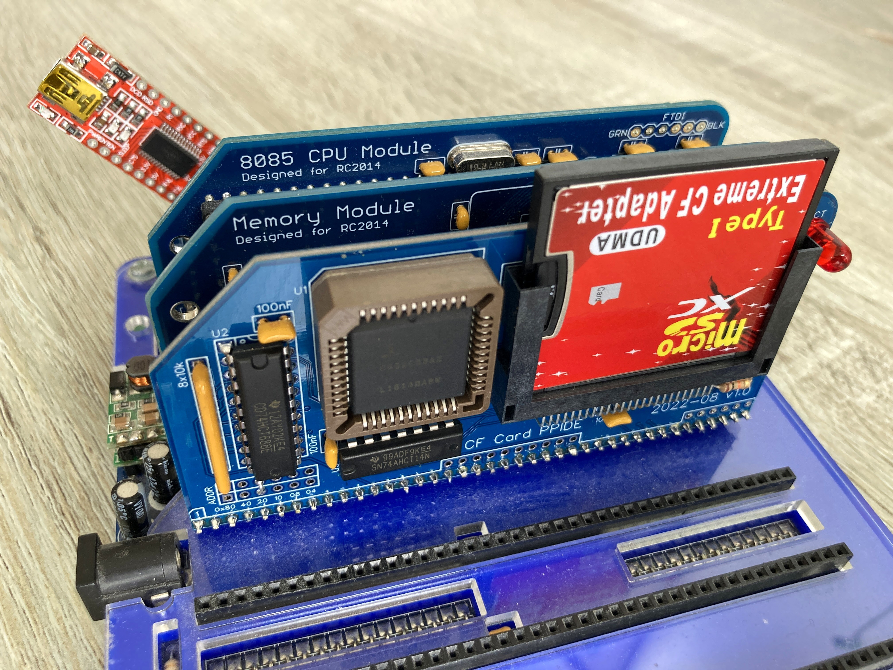</a></td>
</tr>
<tr>
<th style="border: 1px solid #cccccc; padding: 6px;">
RC2014-8085 running CP/M-IDE with SD to CF Storage Adapter
</th>
</tr>
</tbody>
</table>

## Configuration

The modules are configured in their normal settings for CP/M. A jumper for the `PAGE` signal is shown connected via pin 39, although this can be done in any alternative way. The Pageable ROM Module needs to be configured for 32 kB pages. A write to port `$38` toggles that window. The memory map is in [How CP/M-IDE fits](how-it-works.md).

<table style="border: 2px solid #cccccc;">
<tbody>
<tr>
<td style="border: 1px solid #cccccc; padding: 6px;"><a href="https://github.com/feilipu/CPM-IDE/blob/master/docs/P1090691.JPG" target="_blank">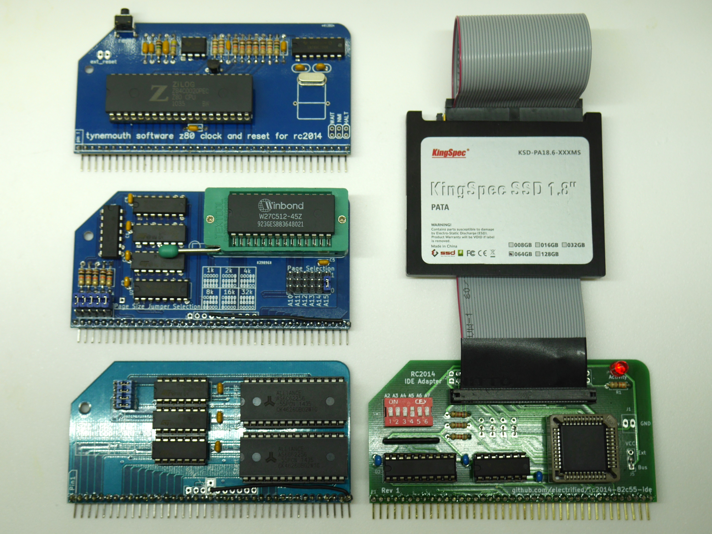</a></td>
</tr>
<tr>
<th style="border: 1px solid #cccccc; padding: 6px;">
RC2014 CP/M-IDE Modules (excl. ACIA)
</th>
</tr>
<tr>
<td style="border: 1px solid #cccccc; padding: 6px;"><a href="https://github.com/feilipu/CPM-IDE/blob/master/docs/IMG_1689.JPG" target="_blank">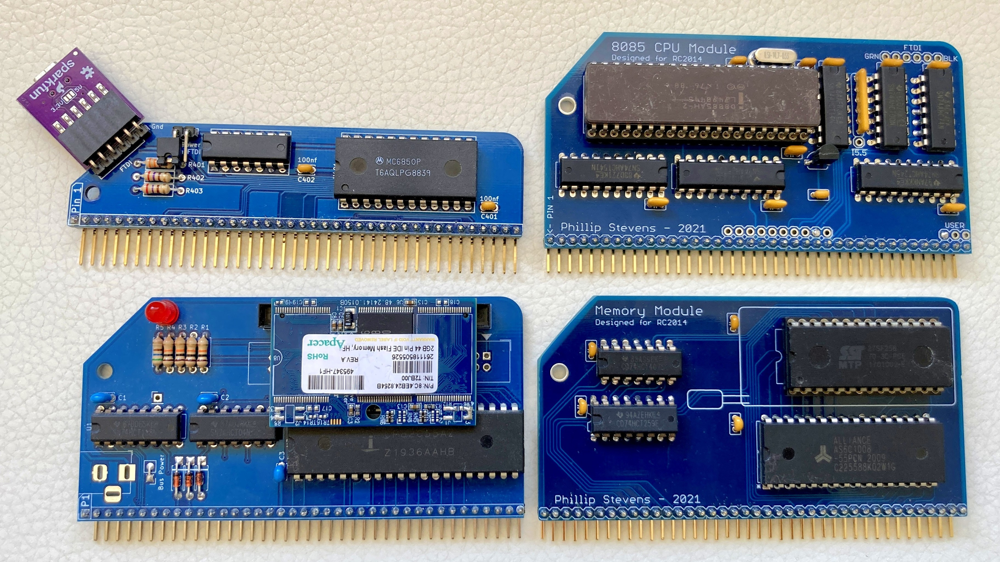</a></td>
</tr>
<tr>
<th style="border: 1px solid #cccccc; padding: 6px;">
RC2014 CP/M-IDE 8085 Modules
</th>
</tr>
<tr>
<td style="border: 1px solid #cccccc; padding: 6px;"><a href="https://github.com/feilipu/CPM-IDE/blob/master/docs/IMG_0536.jpg" target="_blank">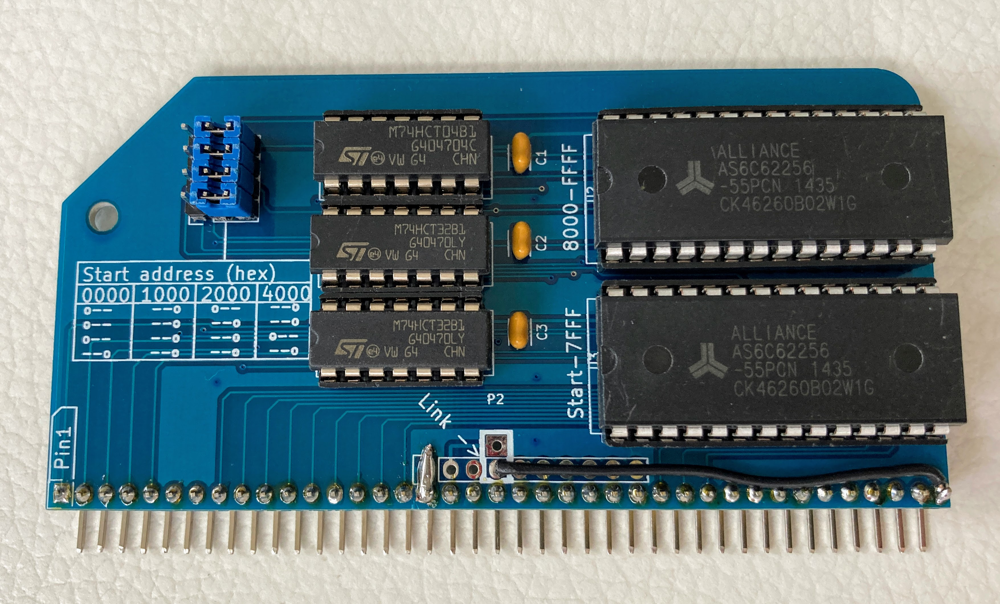</a></td>
</tr>
<tr>
<th style="border: 1px solid #cccccc; padding: 6px;">
RC2014 64kByte RAM Module (note jumper positions)
</th>
</tr>
<tr>
<td style="border: 1px solid #cccccc; padding: 6px;"><a href="https://github.com/feilipu/CPM-IDE/blob/master/docs/IMG_0535.jpg" target="_blank">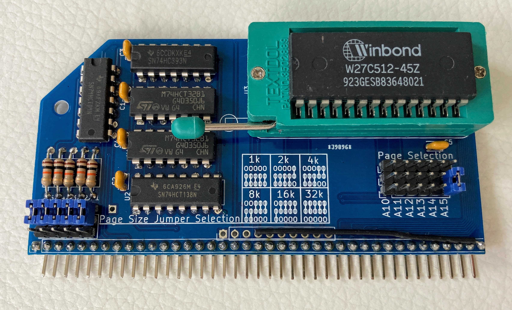</a></td>
</tr>
<tr>
<th style="border: 1px solid #cccccc; padding: 6px;">
RC2014 Pageable ROM Module (note jumper positions)
</th>
</tr>
<tr>
<td style="border: 1px solid #cccccc; padding: 6px;"><a href="https://github.com/feilipu/CPM-IDE/blob/master/docs/IMG_0530.jpg" target="_blank">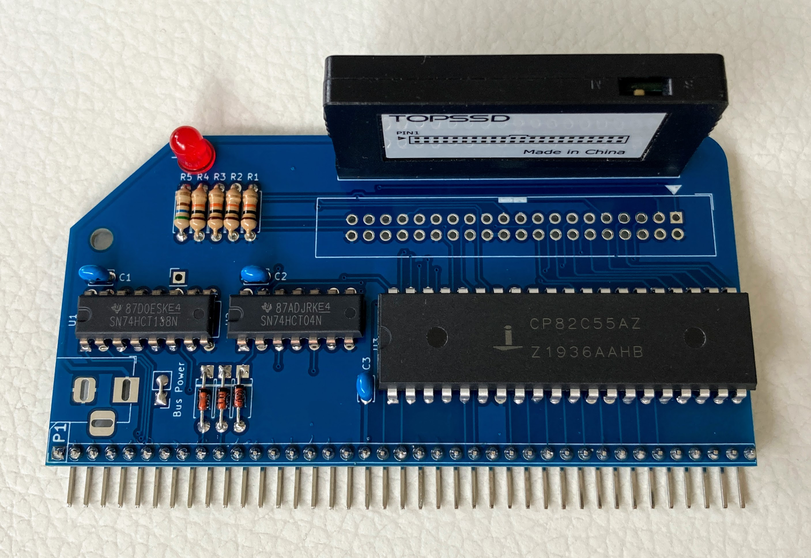</a></td>
</tr>
<tr>
<th style="border: 1px solid #cccccc; padding: 6px;">
RC2014 IDE Hard Drive Module with DOM
</th>
</tr>
<tr>
<td style="border: 1px solid #cccccc; padding: 6px;"><a href="https://github.com/feilipu/CPM-IDE/blob/master/docs/IMG_0532.jpg" target="_blank">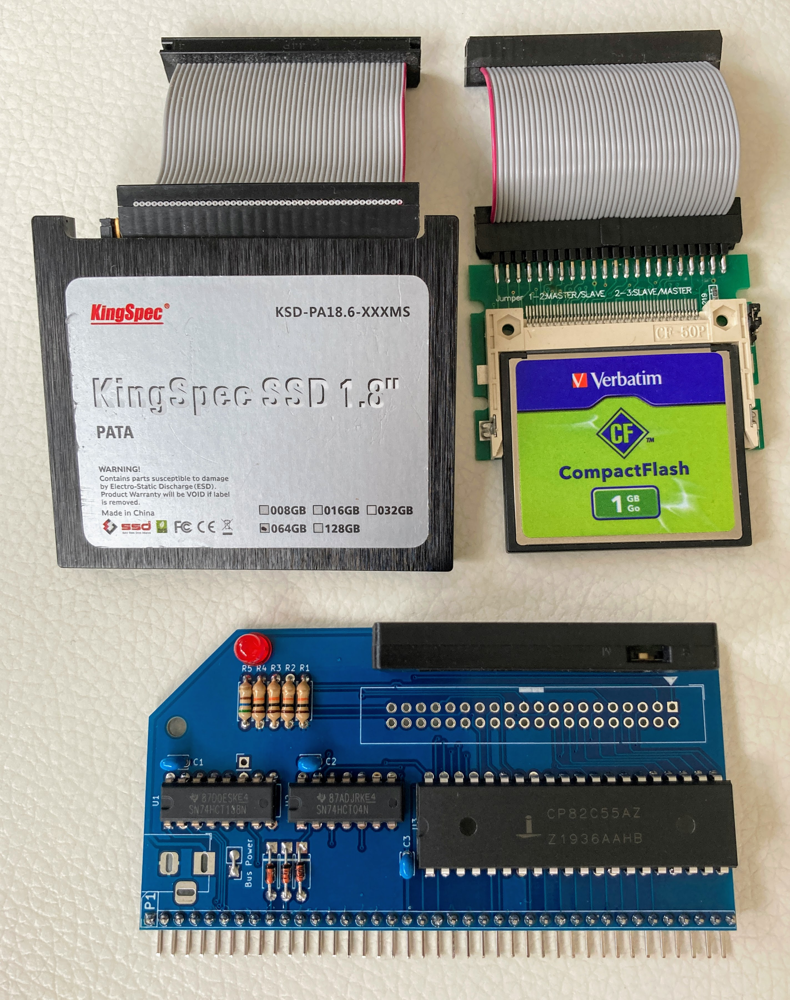</a></td>
</tr>
<tr>
<th style="border: 1px solid #cccccc; padding: 6px;">
RC2014 IDE Hard Drive Module storage options
</th>
</tr>
</tbody>
</table>

