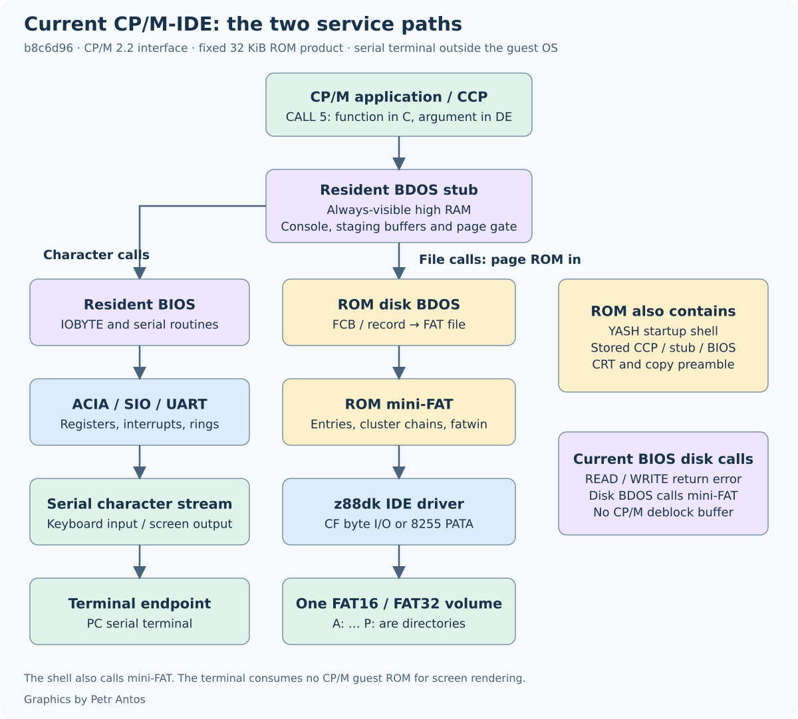
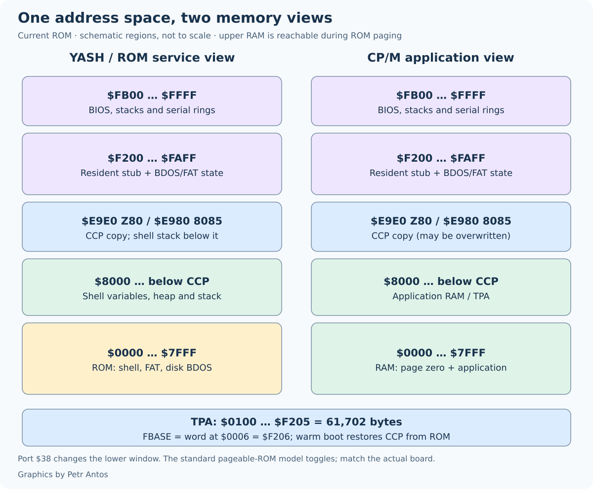

# How CP/M-IDE fits

A program sees an ordinary CP/M 2.2 machine. The transient program area runs from `$0100` up to FBASE. FBASE is the word at `0006h`, which is `$F206` (`jp fbase`). That is 61702 bytes. The card behind it is one FAT16 or FAT32 volume, and each drive letter is a directory on that volume.

The ROM is 32 KiB. It holds the startup, the shell, mini-FAT, the disk half of the BDOS, the IDE driver, and the stored copies of the CCP, the BDOS stub, and the BIOS. The bytes that have to be present while a program runs are copied into the top of RAM. Everything else stays in the ROM and is called when needed. That is what keeps the TPA at `$F206` instead of ending where a full disk BDOS would have sat.

What each BDOS call returns is [The CP/M 2.2 BDOS](bdos.md). The sector and directory layer is [Mini-FAT](mini-fat.md). The CCP changes are [Modifications to the CCP and BDOS](readme_ccp_bdos.md). The build that produced this layout is [CPM-IDE-MSX](CPM-IDE-MSX.md).

A character call stays in the high RAM stub, so a string in the program's memory can be printed without paging. A disk call cannot. The stub copies the file control block or the record above `$8000`, pages the ROM in, and mini-FAT walks the directory. BIOS `read` and `write` are not that path. They return an error. The two routes are the picture.

## Two maps, one set of chips

`$8000`–`$FFFF` is always RAM. `$0000`–`$7FFF` is the window. On the RC2014 pageable ROM a write to port `$38` toggles the window. It is not a bank number. The disk path writes `0`, calls the ROM, and writes `1`, which is the pair that brings the ROM in and then the RAM back. A board that latches the data byte, or that uses another port, is a different circuit. Paging hides the low RAM. It does not erase it. Anything the CPU must touch during the switch, including the serial rings, stays above `$8000`.

While the shell is at the prompt the window is ROM. The shell, mini-FAT, and the disk BDOS run from that ROM. Shell variables sit at `$8000`. On the Z80 PATA image they end at `$81C5`. On the 8085 PATA image they end at `$805F`. The stack grows down from the CCP origin, `$E9E0` on the Z80 and `$E980` on the 8085. The RAM between the variables and that stack is unused. The CCP image is already sitting at the origin, and the stack grows away from it.

`cpm` pages RAM into the window, builds page zero, and jumps to the CCP. From then on a program owns `$0100` up to `$F206`. That range includes the RAM the shell was using, and it includes the CCP. A program may overwrite both. The usual exit is a jump to address 0. That warm boot copies the CCP back from the ROM image before the next prompt. A program that returns into the CCP, instead of jumping to 0, continues with the copy that is already there. `EXIT` goes further: it returns to the shell and the shell starts again, because its variables may have been overwritten too.

| | Shell | CP/M |
| --- | --- | --- |
| `$0000`–`$7FFF` | ROM. Shell, mini-FAT, disk BDOS, IDE driver, stored CCP and BIOS. | RAM. Page zero, then the TPA. |
| `$8000` up to the stack | Shell variables, then unused RAM. | Still the TPA. |
| CCP through `$F1FF` | The CCP image, already copied. The shell stack grows down from its first byte. | The CCP. Copied back by a warm boot. |
| `$F200` upward | BDOS stub, FAT window, BIOS, serial rings. | The same bytes. A program stops at `$F206`. |

## The resident map

The addresses that do not depend on the CPU are the same on all seven ROMs. The 8085 CCP is longer, so it starts lower and still ends at the same stub. The 8085 stub is longer as well. The serial rings differ by module, and they take the last bytes of RAM. The BIOS stack sits under those rings, so its address is not the same on every board. The canary word is the floor of that 16-byte pad.

| | Z80 | 8085 |
| --- | --- | --- |
| CCP | `$E9E0`–`$F1FF` | `$E980`–`$F1FF` |
| CCP stack, 32 bytes | top is `$F200` | top is `$F200` |
| BDOS stub, including the disk parameter block | `$F200`–`$F491` | `$F200`–`$F4C0` |
| `0006h` / FBASE | `$F206` | `$F206` |
| Stub RAM: staged FCB, record, line, stack | `$F492`–`$F6F4` | `$F4C1`–`$F723` |
| BDOS stack | `$F6E8` | `$F717` |
| Disk variables | `$F750`–`$F7C6` | the same |
| FAT volume, directory cursors, `fatwin` | `$F7D0`–`$FA84` | the same |
| BIOS jump table | `$FB00` | `$FB00` |

The 8085 stub is longer because `copy_mem` lives in it. A copy has to run while the window is RAM, and the 8085 has no `ldir`. The Z80 stub uses `ldir`. The stack grows down from `$F6E8` on the Z80 and from `$F717` on the 8085. Disk variables begin at `$F750` on both. The bytes between the stub RAM and `$F750` are unused. That gap is smaller than the 128-byte copy block, so the block stays in the CCP, inside the TPA, and does not push `0006h` down. `fatwin` is the 512-byte sector window, at `$F830`. The sixteen drive clusters, A: through P:, are the first 64 bytes of the FAT block.

On the SIO products the two transmit rings are 32 bytes each and the two receive rings are 128 bytes each, finishing at `$FFFF`. The ACIA receive ring is 256 bytes. The UART receive rings are 128 bytes. The rings are aligned so the index wraps with `inc l` and a mask. The usable depth is one byte under that allocation, which is the 31, 127, and 255 in [Hardware](hardware.md). They are not inside the TPA.

## Why the ceiling is `$F206`

The linker does not know about `PHASE`. A `PHASE` block is stored in the ROM at whatever address the linker reached, and its labels resolve at the high address where it will run. The preamble copies the CCP, the BDOS stub, and the BIOS to those addresses before the shell prompt. A warm boot with the canary still `$AA55` copies the CCP and the stub code again, clears the stub RAM and the disk variables, and leaves the FAT block and the BIOS where they are. The mounted directories survive that path. `EXIT` has changed the canary to `$5555`. That path clears the FAT block, copies the BIOS again, and returns to the shell. The code in the ROM image is the master. The high RAM is the working copy.

A reset that leaves RAM intact is not a fresh power-on. The preamble reads the canary before `main`. The bytes `$55` `$AA` jump to `qboot`, which keeps the volume and enters the CCP. `$55` `$55` is the `EXIT` path. Any other value, including a cleared RAM, is a cold start. The ROM latch has to be in a state where that preamble actually runs. The shell procedure is in [Getting started](getting-started.md).

Mini-FAT, the disk BDOS, and the IDE driver are not phased. They run at the address where they were linked, inside the 32 KiB window. A disk call pages that window in, uses them, and pages RAM back. The TPA does not have to hold them.

v2.6 kept the whole disk BDOS and the disk half of the BIOS in high RAM, because the drive was an 8 MB container file and the BIOS did the sector arithmetic. On the SIO ROMs the word at `0006h` was `$E206`. Moving that work into the ROM raised the ceiling to `$F206` on every product. That is 4 KB.

The CCP is inside the TPA on purpose. Reserving it above `0006h` would shrink every program by the size of the CCP, `$820` bytes on the Z80 and `$880` bytes on the 8085, whether or not the program touched it. A program that stays below the CCP leaves it intact. A program that overwrites it leaves through address 0, and that warm boot copies the CCP back. The ceiling a program should trust is the word at `0006h`. That word is an address limit. It is not a promise that every program can occupy every byte below it and still return.

## The 32 KiB budget

The burned image has to hold all of this at once:

- the startup preamble
- the shell
- mini-FAT
- the disk BDOS
- the IDE or Compact Flash driver
- the stored CCP, BDOS stub, and BIOS

A binary over 32768 bytes is rejected. On the 8085 the code also has to finish by `$7F81`. The largest image is Z80 PATA SIO, 32741 bytes. That leaves 27 bytes, the smallest slack of the seven. The 8085 PATA image ends its code at `$7D0C`, 629 bytes below `$7F81`.

| Product | Bytes | Code end | Left in the 32 KiB |
| --- | ---: | ---: | ---: |
| Z80 CF ACIA | 31978 | `$7C45` | 790 |
| Z80 CF UART | 32393 | `$7DBA` | 375 |
| Z80 CF SIO | 32585 | `$7E79` | 183 |
| Z80 PATA SIO | 32741 | `$7F16` | 27 |
| 8085 CF ACIA | 31759 | `$7BB0` | 1009 |
| 8085 CF UART | 31960 | `$7C79` | 808 |
| 8085 PATA UART | 32107 | `$7D0C` | 661 |

The shell stayed in every image. So did `xget`, the CCP, and both FAT types. The fit is what decided that the disk BDOS and mini-FAT live in the ROM rather than in a second bank or in the TPA.

## Paging

`cboot` writes `$01` after the resident copy is in place, with interrupts still off, and plants the RAM interrupt vector. From there until the next warm boot the window is RAM, except for a disk call.

A disk call cannot read the caller's FCB or the caller's stack while the window is ROM, because both usually sit below `$8000`. The stub, which is above `$8000`, does this before the page:

1. Saves the caller's stack pointer.
2. Switches to the BDOS stack (`$F6E8` on the Z80, `$F717` on the 8085).
3. Copies the FCB, the line, or the 128-byte record into the resident buffers when the function needs it.
4. Writes `$00` to port `$38` and calls the ROM.

The ROM returns to the stub. The stub writes `$01`, copies the result back to the caller's memory, restores the stack pointer, and returns. Function 18 does not read or write the caller's `DE`.

The page itself is one `out`. Interrupts stay enabled across the FAT walk. A long directory scan must not drop bytes at 115200. The byte rings are above the window, so the service routine can store a character with either bank showing. On the Z80 ACIA and the Z80 UART, the ROM's RST 38 and the vector planted in RAM both jump to the one routine in the BIOS. On the 8085 the ROM's own vector at `$0034` runs the serial driver linked into the ROM, and that driver uses the same rings. SIO uses interrupt mode 2. Its vector table is in the BIOS, so the page does not matter.

From the `out` in `cboot` until warm boot latches the ROM back in, the window is RAM. Mini-FAT is in that window. That stretch does not call it.

## Why the serial drivers stay in RAM

An interrupt has to be serviced while the ROM is paged in, and while it is paged out. The byte rings therefore live above `$8000`, inside the BIOS that was copied up at startup. On the Z80, and on SIO, the service routine lives there too, so one copy serves both pages. On the 8085 the ROM holds a second copy, because the ROM vector is fixed at link time and the RAM vector, planted by `cboot`, points at the BIOS copy. Either routine uses the rings at the top of RAM. Neither touches the IDE ports, the sector window, or port `$38`. The IDE wait loop can be interrupted. The routine saves the registers it uses.

The console path of the BDOS stays in the stub for the same reason. Functions 1, 2, 3, 4, 5, 6, 9, and 11 call the BIOS and return. Paging the ROM in and out for each character would cost more than the code, and function 9 walks a string that may sit in the TPA. Function 10, the line editor, pages once for the whole line and edits a staged buffer. Console, reader, punch, and list are the real BIOS routines. A program calls them with the ROM paged out, through the jump table at `$FB00`.

Z80 ACIA and Z80 UART plant `JP` at RAM `$0038` during `cboot`. The 8085 plants `JP` at RAM `$0034`. SIO uses interrupt mode 2, and its vector table is in the BIOS image. The rings wrap at the top of RAM so the index is one byte.

Flow control has to be on at 115200. The receive ring absorbs a burst while a sector is being written. An adapter that wires `/DTR` to pin 6 will still drop characters. The adapter has to drive `/RTS`.

## The BIOS

The BIOS is the Digital Research CP/M 2.2 BIOS, adapted to the RC2014 serial module. The jump table is unchanged in shape. A program that calls `SELDSK`, `READ`, or `WRITE` still lands in this page.

Character entries are the drivers above. `HOME`, `SETTRK`, and `SETSEC` return. `SECTRAN` returns the sector it was given. `READ` and `WRITE` return an error in A. There is no CP/M sector disk and no deblock buffer. `SELDSK` returns one shared disk parameter header when that letter's directory cluster is set, and zero when it is not.

The geometry a program sees is the BDOS disk parameter block: 128-byte records, 2 KB blocks, 8 MB, 512 directory entries, no reserved tracks, no checksum vector. That block describes the CP/M view. It is not the geometry of the card. The card is read and written by mini-FAT, 512 bytes at a time.

Warm boot is the BIOS job. It pages the ROM in, copies the CCP and the stub code, pages RAM out, and enters the CCP with the byte from `$0004` in C. The mounted directories survive when the canary at the bottom of the BIOS stack is still `$AA55`. The BIOS image itself stays as it was on that path. `EXIT` changes the canary to `$5555`. The preamble then clears the drive table, copies the BIOS again, and the shell stays at its prompt.

## Mini-FAT

Mini-FAT is the FAT16 and FAT32 code in the ROM. The shell and the disk BDOS both call it. There is one volume, 512-byte sectors, and short 8.3 names. A cluster number and an LBA are a 32-bit value in BCDE, with E as the low byte.

Every directory entry and every FAT entry passes through `fatwin`. A dirty window is written before a different sector is loaded. Four consecutive 128-byte CP/M records that sit in the same 512-byte sector are one disk read, while that sector remains the window. A sequential read continues from the cluster it already reached, so it does not walk the chain from the start of the file for every record. A seek behind that point walks from the start. A new cluster is taken at the next number when that cluster is free, so a file written here tends to be one run and the FAT sector stays in the window. A fragmented file is still a normal file. The shell follows the chain, and so does the BDOS.

The IDE driver underneath is the z88dk RC2014 driver. One call reads or writes one sector. LBA in BCDE, buffer in HL, carry set when the sector completed. The PATA path is the 8255 at `$20`–`$23`. The Compact Flash path is ports `$10`–`$17`. [Hardware](hardware.md) has the measured rates for that driver. CP/M does not add a second layer of blocking on top of it.

The public C header is `common/fatfs.h`. The calls, and the cases mini-FAT refuses, are in [Mini-FAT](mini-fat.md).

## The BDOS

`CALL 5` enters the stub at `$F206`. C is the function. DE is the argument. The return is the CP/M pair: A and L are the low byte, B and H are the high byte. Function 12 returns `0022h`.

Console, reader, punch, list, IOBYTE, version, the current drive, the DMA address, and the user number run in the stub. Function 10 pages once, as the serial section says. Any other disk function pages the ROM in and runs the matching routine next to mini-FAT. The ROM routine returns HL. The stub publishes that word and pages RAM back.

A CP/M file on the card is one FAT directory entry: the 8.3 name, the attribute, the start cluster, and the size. The FCB the program holds is filled from that entry. It is not stored as a 32-byte CP/M extent. The sixteen allocation bytes in the FCB are zeros. `DIR` lists the name. `STAT`'s per-file size column reads those zeros and looks empty. Function 35 returns the size. Read and write use the cluster chain.

The disk is told as 8 MB even when the card is larger. Free space, function 27, builds its 512-byte allocation vector in `fatwin` and returns that address. The vector is valid until the next disk call, which needs the window for a real sector. Keeping the vector there, instead of reserving 512 bytes under `0006h`, is worth 512 bytes of TPA for every program, including the ones that never ask. The count is the smaller of the free clusters on the card, capped at 8 MB, and the space not yet used by files on that letter. An empty letter on a large card reports 8192k. Each file reduces the figure by its size, rounded up to 2 KB. User 0 is the only user that can see or create files. The directory has no user field.

The full return for each call is [The CP/M 2.2 BDOS](bdos.md).

## What is worth knowing in practice

A `.COM` starts at `$0100`. It may use memory up to `$F206`. A jump to address 0 copies the CCP back, and it copies the stub code as well. The FAT window and the BIOS stay. A return into the CCP does not copy anything, so that return needs the CCP still intact. NZ-COM replaces a BDOS that lives in RAM. On this ROM the disk BDOS is in the ROM, so that load belongs to the v2.6 machine, which is [CP/M-IDE v2.6](CPM-IDE-v2.6.md). The NGS Microshell is `SH` on the system image. The Digital Research CCP stays in ROM and warm boot copies it back. Type `SH` at the prompt, or leave `SH` in `A:$$$.SUB` so the CCP runs it at start.

Page zero is the usual CP/M page. `$0000` warm-boots. Address 3 is the IOBYTE. Address 4 is the user and the drive. `$0005` jumps to `$F206`. The default DMA buffer is `$0080` and the default FCB is `$005C`.

`SD`, `SURVEY`, and `STAT` report the 8 MB disk, not the free clusters of the whole card. A file written here is an ordinary 8.3 name in the letter's directory. It can be copied off the card from a host without a CP/M tool.

<a href="../README.md">Back</a>

